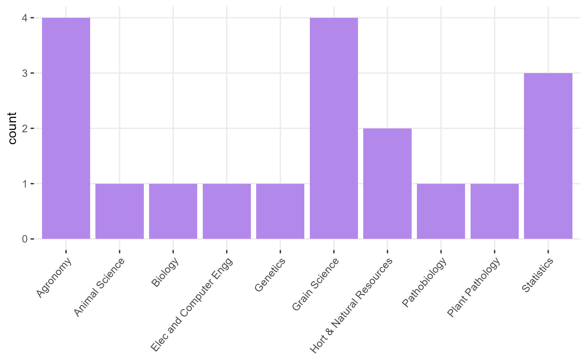
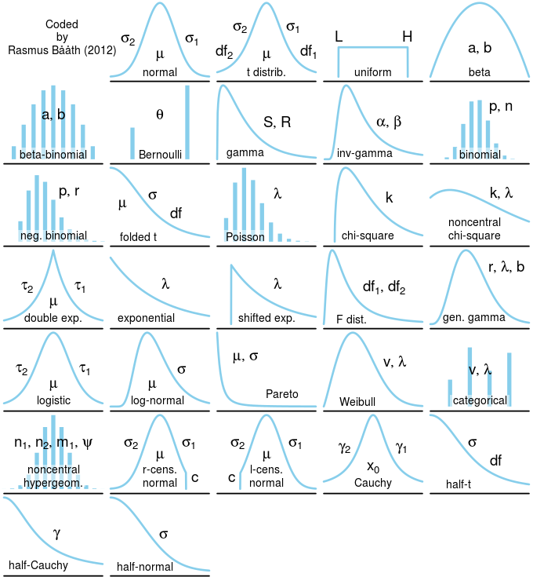

--- 
title: "STAT 870 - Analysis of Messy Data"
author: "Josefina Lacasa"
date: Fall 2026 #"`r Sys.Date()`"
site: bookdown::bookdown_site
---

# Welcome to STAT 870!  
August 24th, 2026  

## About this course:  

- [About me](https://jlacasa.github.io/) 
- About you: 

```{r echo=FALSE, fig.cap="Students of this class", out.width = '80%', fig.align='center'}

```

```{r eval=FALSE, message=FALSE, warning=FALSE, include=FALSE}
library(tidyverse)
read.csv("../../students_STAT_870_A.csv") |>
  filter(degreeProgram != "") |> 
  ggplot(aes(x = degreeProgram))+
  geom_bar(fill = "#B388EB")+
  theme_bw()+
  theme(panel.grid.minor = element_blank(),
        panel.border = element_blank(),
        axis.title.x = element_blank(),
        axis.text.x = element_text(angle = 50, vjust = 1, hjust=1))
ggsave("../figures/students.jpg")
```

- In rounds: What's your major and what do you expect to learn in 870?  

### Logistics  

- [Website](https://stat870.github.io/fall2026/)
- Syllabus 
- Statistical programming requirements  
- Rough mindmap of the course (on whiteboard)  
- [Semester project](https://stat870.github.io/fall2026/notes/semester-project.html)   
- Grades: A (100-89.999999999(!!!)), B (89.99-79.99), C (79.99-69.99), D (69.99-59.99), F (<59.99).
- Attendance policies, kahoots, in-class exercises  

## Learning goals   

By the end of this course, you should be able to:  

- Identify the treatment design, experiment design, experimental unit and observational unit of simple and complex designed experiments.  
- Distinguish the benefits/disadvantages of different experiment designs.  
- Write the statistical model that corresponds to data generated by designed experiments.  
- Write the Materials and Methods section in a paper (or thesis) that describes the designed experiment.  

```{r include=FALSE}
popup_btn <- function(button_text = "try me", modal_text = "example text") {
  # Generate a unique ID to avoid script conflicts if multiple modals are on one page
  id <- paste0("modal_", paste0(sample(letters, 6, replace = TRUE), collapse = ""))
  
  html <- sprintf('
    <div style="text-align: center; margin: 20px 0;">
      <button id="%1$s_btn" style="padding: 10px 15px; background-color: #B388EB; color: white; border: none; border-radius: 5px; cursor: pointer; font-weight: bold;">%2$s</button>
    </div>
    <div id="%1$s_modal" style="display:none; position:fixed; z-index:9999; left:0; top:0; width:100%%; height:100%%; overflow:auto; background-color:rgba(0,0,0,0.5);">
      <div style="background-color:#fff; margin:15%% auto; padding:20px; border:1px solid #888; width:80%%; max-width:500px; border-radius:10px; font-family: sans-serif;">
        <span id="%1$s_close" style="color:#aaa; float:right; font-size:28px; font-weight:bold; cursor:pointer;">&times;</span>
        <p>%3$s</p>
      </div>
    </div>
    <script>
      (function() {
        var modal = document.getElementById("%1$s_modal");
        var btn = document.getElementById("%1$s_btn");
        var span = document.getElementById("%1$s_close");
        if (btn) { btn.onclick = function() { modal.style.display = "block"; } }
        if (span) { span.onclick = function() { modal.style.display = "none"; } }
        window.onclick = function(event) { if (event.target == modal) { modal.style.display = "none"; } }
      })();
    </script>
  ', id, button_text, modal_text)
  
  htmltools::HTML(html)
}
```


## Overview of the course 

```{r echo=FALSE, fig.cap="Mindmap", out.width = '80%', fig.align='center'}
knitr::include_graphics("../figures/mindmap_1.jpg")
```

## What advice would you give to future students of this course?

- "As soon as you begin class, start looking for a class project and working on it too, because time flies, and before you know it, the semester is over. Starting your class project early will definitely help you benefit the most from the class as you work on your project concurrently with learning important concepts in class." 
- "don't skip class" 
- "Make sure to take advantage of office hours and read the material in the texts"

## What is messy data anyways?

- Complex dependence structures 
- Complex structure in covariates 

## Linear Models review 

Perhaps the most common model of all time (default in most software) is 

$$y_{i} = \mu_i + \varepsilon_i, \ \varepsilon_i \sim N(0, \sigma^2),$$

where: 

- $y_{i}$ is the observed value for the $i$th observation, 
- $\mu_i$ is the expected value for the $i$th observation, 
- $\varepsilon_i$ is the residual (i.e., the difference between observed and expected). All residuals are iid normal.  
This example uses the model equation form. 

The model above can also be written usign the probability distribution form. The probability distribution form is much more flexible because it is compatible with other distributions beyond the normal. It goes like this:

$$y_{i} \sim N(\mu_i, \sigma^2),$$
where the elements are the same as described above. 

Likewise, we can use the vectorized notation of the probability distribution form, and say that 

$$\mathbf{y} \sim N(\boldsymbol\mu, \sigma^2 \mathbf{I}),$$
where: 

- $\mathbf{y} \equiv [y_1, y_2, ..., y_n]'$ is the vector of observed values, 
- $\boldsymbol\mu \equiv [\mu_1, \mu_2, ..., \mu_n]'$ is the vector of expected values, 
- $\sigma^2 \mathbf{I}$ is the variance-covariance matrix. Note that, more generally, we can call the variance-covariance matrix $\boldsymbol{\Sigma}$ or $\mathbf{V}$. 


Note that
$$\sigma^2 \mathbf{I} = \sigma^2 \begin{bmatrix} 
1 & 0 & 0 & \dots & 0 \\
0 & 1 & 0 & \dots & 0 \\
0 & 0 & 1 & \dots & 0 \\
\vdots & \vdots & \vdots & \ddots & \vdots \\
0 & 0 & 0 & \dots & 1 \end{bmatrix}
= \begin{bmatrix} 
\sigma^2 & 0 & 0 & \dots & 0 \\
0 & \sigma^2 & 0 & \dots & 0 \\
0 & 0 & \sigma^2 & \dots & 0 \\
\vdots & \vdots & \vdots & \ddots & \vdots \\
0 & 0 & 0 & \dots & \sigma^2 \end{bmatrix}.$$

The assumptions behind this model are:

- Normal distribution of the data 
- Constant variance 
- Independence 
- Linearity 

In this course, we will mostly deal with cases where: 

- The assumption of independence does not hold (basic and complex designed experiments), 
- The assumption of normality does not make sense (e.g., data are counts, proportions, or stricly positive), 
- The assumption of constant variance does not hold/make sense (e.g., larger biomass is associated to larger variance of said biomass). 

We will approach most problems with a 3-step approach (Chapter 2 in Stroup et al.): 

- What is the distribution of the data? 
- What is the link function? 
- What is the blueprint of the design/data? 

```{r echo=FALSE, fig.cap="Common variable distributions. Page 60 in Stroup et al. (2024)", out.width = '80%', fig.align='center'}
knitr::include_graphics("../figures/stroup_distributions.jpg")
```

## On notation  

- scalars: $y$, $\sigma$, $\beta_0$  
- vectors: $\mathbf{y} \equiv [y_1, y_2, ..., y_n]'$, $\boldsymbol{\beta} \equiv [\beta_1, \beta_2, ..., \beta_p]'$, $\boldsymbol{u}$  
- matrices: $\mathbf{X}$, $\Sigma$  
- probability distribution: $y \sim N(0, \sigma^2)$, $\mathbf{y} \sim N(\boldsymbol{0}, \sigma^2\mathbf{I})$.     

## Designed experiments review

- Please watch YouTube recordings!

## Homework & Announcements  

- Install R and RStudio. 
- Submit [Assignment 1](https://stat870.github.io/fall2026/assignments/Assignment1_YourLastName.pdf) by next Monday. 
- Read Chapter 2 in Stroup et al. (2024) 
- Chapter 4 in Messy Data Vol1 (Milliken & Johnson)


<!--chapter:end:index.Rmd-->

# Designed Experiments Review      
August 26th  

## Announcements

- [Assignment 1](https://stat870.github.io/fall2026/assignments/Assignment1_YourLastName.pdf) is due next Wednesday. 
- Applied Linear Mixed Models Workshop 09/19-09/20.  

## Designed experiments  

The golden rules of designed experiments: 

- Replication 
- Randomization 
- Local control 

```{r echo=FALSE, fig.cap="Principles for conducting valid and efficient experiments. From Box, Hunter and Hunter (2005).", out.width = '80%', fig.align='center'}
knitr::include_graphics("../figures/principles.jpg")
```

- About George Box I - A Conversation with George Box [[link](https://projecteuclid.org/journals/statistical-science/volume-2/issue-3/A-Conversation-with-George-Box/10.1214/ss/1177013223.full)] 
- About George Box II - An Accidental Statistician: The Life and Memories of George E. P. Box [[link](https://www.amazon.com/Accidental-Statistician-Life-Memories-George/dp/1118400887)] 


### Treatment structure

- Solely about the treatment. 
- Most likely connected to the research question and thus defined by the subject matter expert.  

```{r echo=FALSE, fig.cap="Schematic representation of a one-way treatment structure.", out.width = '80%', fig.align='center'}
knitr::include_graphics("../figures/trtdesigns_oneway.PNG")
```


A one-way treatment structure means that the expected value of the observations, $y$, is affected by one treatment factor with $k$ levels:   

$$g(\mu_{ij}) = \eta_{ij} = \eta_{0} + T_i,$$
where:

- $\mu_{ij}$ is the expected value of $y_{ij}$, the observation of the $i$th treatment and $j$th repetition, 
- $g(\cdot)$ is the link function, that ensures that the mean is within the support of the chosen distribution, 
- $\eta_{ij}$ is the linear predictor of $g(\mu_{ij})$, 
- $\eta_{0}$ is the overall mean, and 
- $T_i$ is the effect of the $i$th level of the treatment $T$. 

```{r echo=FALSE, fig.cap="Schematic representation of a two-way factorial treatment structure.", out.width = '80%', fig.align='center'}
knitr::include_graphics("../figures/trtdesigns_twoway.PNG")
```

A two-way treatment structure is similar to a one-way treatment structure, only now the expected value is affected by two treatment factors:   

$$g(\mu_{ijk}) = \eta_{ijk} = \eta_{0} + T_i + G_j + (TG)_{ij} ,$$
where:

- $\mu_{ijk}$ is the expected value of $y_{ij}$, the observation of the $i$th treatment $T$, $j$th treatment $G$, and $k$ repetition, 
- $g(\cdot)$ is the link function, that ensures that the mean is within the support of the chosen distribution, 
- $\eta_{ijk}$ is the linear predictor of $g(\mu_{ijk})$, 
- $\eta_{0}$ is the overall mean,  
- $T_i$ is the effect of the $i$th level of the treatment $T$, 
- $G_j$ is the effect of the $j$th level of the treatment $G$, and 
- $(TG)_{ij}$ is the interaction between the $i$th level of treatment $T$, and $j$th level of treatment $G$. 

```{r echo=FALSE, fig.cap="Schematic representation of a tree-way factorial treatment structure.", out.width = '80%', fig.align='center'}
knitr::include_graphics("../figures/trtdesigns_threeway.PNG")
```


Other treatment structures: 

```{r echo=FALSE, fig.cap="Schematic representation of a two-way fractional factorial treatment structure.", out.width = '80%', fig.align='center'}
knitr::include_graphics("../figures/trtdesigns_twowayfract.PNG")
```


```{r echo=FALSE, fig.cap="Schematic representation of a two-way factorial plus a control treatment structure.", out.width = '80%', fig.align='center'}
knitr::include_graphics("../figures/trtdesigns_twoway_control.PNG")
```


### Design structure  

The experiment design describes the data generating process ("blueprint" of the data). 

- You'll notice that the models above only consider the treatment sources of variability to explain variations in the observed values. 
- How were the treatments above (logistically) applied? 

**Useful questions:** 

- What is the experimental unit?  
- What is the blueprint of the design? (which observations are similar to what) 

While the treatment structure defines what effects we will try and estimate as precisely as possible, the design structure tells us the story of **how** those treatments were applied. 
Some of the most common designed experiments include 

- completely randomized design (CRD), 
- randomized complete block design (RCBD), 
- split-plot design, 
- relevant variations to the designs above:  
  - generalized randomized complete block design, 
  - strip-plot design, 
  - repeated measures designs. 

```{r echo=FALSE, fig.cap="Schematic description of an experiment with a completely randomized design", out.width = '100%'}
knitr::include_graphics("../figures/designs_crd.PNG")
```


```{r echo=FALSE, fig.cap="Schematic description of an experiment with a randomized complete block design", out.width = '100%'}
knitr::include_graphics("../figures/designs_rcbd.PNG")
```


```{r echo=FALSE, fig.cap="Schematic description of a field experiment with a split-plot design", out.width = '100%'}
knitr::include_graphics("../figures/designs_splitplot.PNG")
```

## Statistical models 

- What are the sources of variability? 
- What is the distribution of the data?
- What is the structure in the data?


```{r echo=FALSE, fig.cap="Schematic representation of the relationship between the experiment design and the statistical model.", out.width = '80%', fig.align='center'}
knitr::include_graphics("../figures/mindmap2.jpg")
```

## Homework & Announcements  

- Submit [Assignment 1](https://stat870.github.io/fall2026/assignments/Assignment1_YourLastName.pdf) by next Wednesday. 


<!--chapter:end:02-design1.Rmd-->

# Designed Experiments connection to Linear Mixed Models      

August 31st   

## Announcements

- [Assignment 1](https://stat870.github.io/fall2026/assignments/Assignment1_YourLastName.pdf) is due Wednesday! 
- Applied Linear Mixed Models Workshop 09/19-09/20. [Registration](https://www.k-state.edu/digital-ag-advanced-analytics/events/linear-mixed-models-2026.html) 
- Read Chapter 2 of the Stroup et al. GLMM book (for this chapter only, 1ed is better than 2ed).  

## Semester project 

- Proposal [due September 17th](https://stat870.github.io/fall2026/notes/semester-project-1.html#partial-deadlines) -- [see example 1](https://stat870.github.io/fall2026/assignments/proposal_example.pdf) | [see example 2](https://stat870.github.io/fall2026/assignments/proposal_example2.pdf)
- Must contain: Background, Objectives.  
- Data for the project must be ready to go. 
- Final product: Manuscript + Tutorial. 
- Working in teams vs. solo. 
- Start as soon as possible! 

## Designed experiments  

Let's review the basics of designed experiments:  

- Research question 
- Planning the experiment  
- Treatment structure - directly dependent on the research question 
- Design structure - mostly depending on logistics. May depend on the research question. 

### Design structures  

While the treatment structure defines what effects we will try and estimate as precisely as possible, the design structure tells us the story of **how** those treatments were applied. 
Some of the most common designed experiments include: 

- completely randomized design (CRD), 
- randomized complete block design (RCBD), 
- split-plot design, 
- relevant variations to the designs above:  
  - generalized randomized complete block design, 
  - strip-plot design, 
  - repeated measures designs. 

```{r echo=FALSE, fig.cap="Schematic description of an experiment with a completely randomized design", out.width = '100%'}
knitr::include_graphics("../figures/designs_crd.PNG")
```


```{r echo=FALSE, fig.cap="Schematic description of an experiment with a randomized complete block design", out.width = '100%'}
knitr::include_graphics("../figures/designs_rcbd.PNG")
```


```{r echo=FALSE, fig.cap="Schematic description of a field experiment with a split-plot design", out.width = '100%'}
knitr::include_graphics("../figures/designs_splitplot.PNG")
```


## Fixed versus random effects 

In what follows, we have a brief elaboration of what it means to model that "structure in the data" (i.e., the groups of similarly generated points). 

### Going from fixed effects to fixed+random effects  

The data below were generated by an experiment that tested 18 sorghum genotypes in a randomized complete block design. 

- Discuss the treatment structure 
- Discuss the design structure 

```{r message=FALSE, warning=FALSE}
library(tidyverse)
dat_blocked <- agridat::omer.sorghum |> filter(env == "E3")

str(dat_blocked)
```

Now, remember that the blocks are supposed to indicate "groups of similar experimental units". 
Said "groups of similar experimental units" means that the assumption of independence between all observations (i.e., $y_{ij} = \mu_{0} + G_i + \varepsilon_{ij}$ and $\boldsymbol\varepsilon \sim N(\boldsymbol{0}, \sigma^2 \mathbf{I})$) would be kind of a stretch. 
In reality, all observations from the same block (are supposed to) have *something* in common. 
It's not reasonable to assume that the observations are independent, because observations from the same field have more in common than observations from different fields. 
They share more similar soil and, with that, a baseline fertility and yield. 

Basically, we expect the genotypes' relative performance to be similar across fields, but the baseline (a.k.a., the intercept) to be field-specific. Then, we could say    
$$y_{ij} = \beta_{0j} + G_i + \varepsilon_{ij}, \\ \varepsilon_{ij} \sim N(0, \sigma^2),$$  
where $\beta_{0j}$ is a block-specific intercept (i.e., $\beta_0 + b_j$, where $\beta_0$ is the overall intercept and $b_j$ is the block effect), and $G_i$ is the genotype effect.  
Now, there are different ways to model that block-specific intercept. 

This is a big forking path in statistical modeling. 
All-fixed models estimate the effects of **everything**. 
Mixed-effects models indicate *what is similar to what* via random effects. 

**Fixed effects** 

We could define an all-fixed model,  

$$y_{ij} = \beta_{0j} + G_i + \varepsilon_{ij}, \\ \beta_{0j} = \beta_0 + u_j \\ \varepsilon_{ij} \sim N(0, \sigma^2),$$  

where $u_j$ is the effect of the $j$th block on the intercept (i.e., on the baseline). 
In this case, $u_j$ is a fixed effect, which means it may be estimated via least squares estimation or maximum likelihood estimation. 
Under both least squares and maximum likelihood (assuming normal distribution), we may estimate the parameters by computing 

$$\hat{\boldsymbol{\beta}}_{ML} = (\mathbf{X}^T\mathbf{X})^{-1}\mathbf{X}^T\mathbf{y},$$

which yields the minimum variance unbiased estimate of $\boldsymbol{\beta}$. 

We still have $$\boldsymbol{\Sigma} = 
\begin{bmatrix} \sigma_{\varepsilon}^2 & 0 & 0 & 0 & \dots & 0 \\ 
0 & \sigma_{\varepsilon}^2 & 0 & 0 & \dots & 0 \\
0 & 0 & \sigma_{\varepsilon}^2 & 0 & \dots & 0 \\
0 & 0 & 0 & \sigma_{\varepsilon}^2 & \dots & 0 \\
\vdots & \vdots & \vdots & \vdots & \ddots & \vdots\\  
0 & 0 & 0 & 0 & \dots & \sigma_{\varepsilon}^2 \end{bmatrix}$$. 


```{r}
m_fixed <- lm(yield ~ gen + rep, data = dat_blocked)

summary(m_fixed)
```

**Random effects** 

We could also assume that the effects of the $j$th block (i.e., $u_j$) arise from a random distribution. 
The most common assumption (and the default in most statistical software) is that 

$$u_j \sim N(0, \sigma^2_b).$$

Now, we don't estimate the effect, but the variance $\sigma^2_b$. 
Note that there are $J$ levels of the random effects, meaning that a random effect is always **categorical**.  
Also, now 

$$\hat{\boldsymbol{\beta}}_{REML} = (\mathbf{X}^T \mathbf{V}^{-1} \mathbf{X})^{-1}\mathbf{X}^T \mathbf{V}^{-1} \mathbf{y},$$

where $\mathbf{V} = Var(\mathbf{y})$ is the variance-covariance matrix of $\mathbf{y}$, 
including residual variance and random-effects variance. Note that this formula yields 
the same point estimate for $\boldsymbol{\beta}$, but with a different confidence interval.  

Now, the variance-covariance matrix $\boldsymbol{\Sigma}$ of the marginal distribution has changed. 

```{r}
library(lme4)
m_mixed <- lmer(yield ~ gen + (1|rep), data = dat_blocked)

summary(m_mixed)
```

## Generalities on mixed models 

Mixed models combine fixed effects and random effects. 
Generally speaking, we can write out a mixed-effects model using the model equation form, as   

$$\mathbf{y} = \mathbf{X} \boldsymbol{\beta} + \mathbf{Z}\mathbf{u} + \boldsymbol{\varepsilon}, \\ 
\begin{bmatrix}\mathbf{u} \\ \boldsymbol{\varepsilon} \end{bmatrix} \sim \left(
\begin{bmatrix}\boldsymbol{0} \\ \boldsymbol{0} \end{bmatrix}, 
\begin{bmatrix}\mathbf{G} & \boldsymbol{0} \\
\boldsymbol{0} & \mathbf{R} \end{bmatrix} 
\right),$$

where $\mathbf{y}$ is the observed response, 
$\mathbf{X}$ is the matrix with the explanatory variables, 
$\mathbf{Z}$ is the design matrix,
$\boldsymbol{\beta}$ is the vector containing the fixed-effects, 
$\mathbf{u}$ is the vector containing the random effects, 
$\boldsymbol{\varepsilon}$ is the vector containing the residuals, 
$\mathbf{G}$ is the variance-covariance matrix of the random effects, 
and $\mathbf{R}$ is the variance-covariance matrix of the residuals. 
Note that $\mathbf{X} \boldsymbol{\beta}$ is the fixed effects part of the model, and 
$\mathbf{Z}\mathbf{u}$ is the random effects part of the model.


Using the probability distribution form, we can then say that $E(\mathbf{y}) = \mathbf{X}\boldsymbol{\beta}$ 
and $Var(\mathbf{y}) = \mathbf{V} = \mathbf{Z}\mathbf{G}\mathbf{Z}' + \mathbf{R}$. 
Usually, we assume $$\mathbf{G} = \sigma^2_u 
\begin{bmatrix} 1 & 0 & 0 & \dots 0 \\
0 & 1 & 0 & \dots & 0 \\
0 & 0 & 1 & \dots & 0 \\
\vdots & \vdots & \vdots & \ddots & \vdots \\
0 & 0 & 0 & \dots & 1
\end{bmatrix}$$ and  $$\mathbf{R} = \sigma^2 
\begin{bmatrix} 1 & 0 & 0 & \dots & 0 \\
0 & 1 & 0 & \dots & 0 \\
0 & 0 & 1 & \dots & 0 \\
\vdots & \vdots & \vdots & \ddots & \vdots \\
0 & 0 & 0 & \dots & 1
\end{bmatrix} $$. 

Then,   

$$\mathbf{y} \sim N(\boldsymbol{\mu}, \Sigma), \\ 
\Sigma = \begin{bmatrix} \sigma^2 + \sigma^2_u & \sigma^2_u & 0 & 0 & 0 & 0 &\dots & 0\\
\sigma^2_u & \sigma^2 + \sigma^2_u & 0 & 0 & 0 & 0 & \dots & 0 \\
0 & 0 & \sigma^2 + \sigma^2_u & \sigma^2_u  & 0 & 0 & \dots & 0 \\
0 & 0 & \sigma^2_u & \sigma^2 + \sigma^2_u  & 0 & 0 & \dots & 0 \\
0 & 0 & 0 & 0 & \sigma^2 + \sigma^2_u & \sigma^2_u  & \dots & 0 \\
0 & 0 & 0 & 0 & \sigma^2_u & \sigma^2 + \sigma^2_u  & \dots & \vdots \\
\vdots & \vdots & \vdots & \vdots & \vdots & \vdots & \ddots & \vdots \\ 
0 & 0 & 0 & 0 & 0 & 0 & \dots & \sigma^2 + \sigma^2_u
\end{bmatrix}.$$

Take your time to digest the variance-covariance matrix above. What type of data do you think generated it? 

```{r echo=FALSE, message=FALSE, warning = FALSE}
Z <- getME(m_mixed, "Z")
sigma2_b <- 70
sigma <- 160

G <- diag(rep(sigma2_b^2, 4))

Z %*% G %*% t(Z) %>%
  as.matrix() %>% 
  as.data.frame() %>% 
  rownames_to_column("x") %>% 
  pivot_longer(cols = -c(x), names_to = "y") %>%
  mutate(x = as.numeric(x), y= as.numeric(y)) %>% 
  
  left_join(
  diag(sigma^2, nrow = nrow(dat_blocked)) %>% 
  as.data.frame() %>% 
  rownames_to_column("x") %>% 
  pivot_longer(cols = -c(x), names_to = "y") %>%
  mutate(y = str_replace(y, "V", "") %>% as.numeric(),
         x = as.numeric(x)) %>% 
  rename(s2 = value)) %>% 

  ggplot(aes(-x,y))+
  geom_tile(aes(fill = value+s2))+
  theme_minimal()+
  scale_fill_viridis_c()+
  labs(fill = "variance/covariance", 
       title = "Variance-covariance matrix\nof the marginal distribution \nfor the data in the\nsorghum block example.")+
  theme(aspect.ratio = 1, 
        axis.text = element_blank(), 
        legend.position = "bottom",
        panel.grid = element_blank(), 
        axis.title = element_blank(), 
        axis.ticks = element_blank())
```

### Random effects    

- By definition, random effects are regression coefficients that arise from a random distribution. 
- Typically, a random effect $u \sim N(0, \sigma^2_u)$.   
- Note that this model for the parameter may result in shrinkage. 
- We estimate the variance $\sigma^2_u$.  
- Calculating degrees of freedom can get much more complex than in all-fixed effects models (e.g., with unbalanced data, spatio-temporally correlated data, or non-normal data).  
- In the context of designed experiments, random effects are assumed to be independent to each other and independent to the residual.  


### Estimation of parameters   

"Estimation" is a term held mostly exclusive to fixed effects and variance components. 
Restricted maximum likelihood estimation (REML) is the default in most mixed effects models because, for small data (aka most experimental data), maximum likelihood (ML) provides variance estimates that are downward biased.
- In REML, the likelihood is maximized after accounting for the model’s fixed effects.  

- In ML, $\ell_{ML}(\boldsymbol{\sigma; \boldsymbol{\beta}, \mathbf{y}}) = - (\frac{n}{2}) \log(2\pi)-(\frac{1}{2}) \log ( \vert \mathbf{V}(\boldsymbol\sigma) \vert ) - (\frac{1}{2}) (\mathbf{y}-\mathbf{X}\boldsymbol{\beta})^T[\mathbf{V}(\boldsymbol\sigma)]^{-1}(\mathbf{y}-\mathbf{X}\boldsymbol{\beta})$  
- In REML, $\ell_{REML}(\boldsymbol{\sigma};\mathbf{y}) = - (\frac{n-p}{2}) \log (2\pi) - (\frac{1}{2}) \log ( \vert \mathbf{V}(\boldsymbol\sigma) \vert ) - (\frac{1}{2})log \left(  \vert \mathbf{X}^T[\mathbf{V}(\boldsymbol\sigma)]^{-1}\mathbf{X} \vert \right) - (\frac{1}{2})\mathbf{r}[\mathbf{V}(\boldsymbol\sigma)]^{-1}\mathbf{r}$, 
where $p = rank(\mathbf{X})$, $\mathbf{r} = \mathbf{y}-\mathbf{X}\hat{\boldsymbol{\beta}}_{ML}$.  
  - Start with initial values for $\boldsymbol{\sigma}$, $\tilde{\boldsymbol{\sigma}}$.  
  - Compute $\mathbf{G}(\tilde{\boldsymbol{\sigma}})$ and $\mathbf{R}(\tilde{\boldsymbol{\sigma}})$.  
  - Obtain $\boldsymbol{\beta}$ and $\mathbf{b}$.   
  - Update $\tilde{\boldsymbol{\sigma}}$.  
  - Repeat until convergence.  


### Fixed effects versus random effects  

What is behind a random effect:  

- $\hat{\boldsymbol{\beta}} \sim N \left( \boldsymbol{\beta}, (\mathbf{X}^T \mathbf{V}^{-1} \mathbf{X})^{-1} \right)$ 
- $u_j \sim N(0, \sigma^2_u)$ 
- What process is being studied?  
- How were the levels selected? (randomly, carefully selected)  
- How many levels does the factor have, vs. how many did we observe?   
- BLUEs versus BLUPs. 

Read more in in Gelman (2005, page 20), "Analysis of variance—why it is more important than ever" [[link](https://projecteuclid.org/journals/annals-of-statistics/volume-33/issue-1/Analysis-of-variancewhy-it-is-more-important-than-ever/10.1214/009053604000001048.full)], and [Gelman and Hill (2006), page 245](https://sites.stat.columbia.edu/gelman/arm/). 


## Homework & Announcements  

- [Assignment 1](https://stat870.github.io/fall2026/assignments/Assignment1_YourLastName.pdf) due Wednesday. 
- Applied Linear Mixed Models Workshop. 

<!--chapter:end:03-LMM.Rmd-->

# Linear mixed models  

September 2nd

## Announcements 

- Applied Linear Mixed Models Workshop 09/19-09/20. [Registration](https://www.k-state.edu/digital-ag-advanced-analytics/events/linear-mixed-models-2026.html) 
- [How to learn hard things](https://www.youtube.com/watch?v=RrLKXRXVrKM) 
- Read Chapter 2 of the Stroup et al. GLMM book (for this chapter only, 1ed is better than 2ed).  

**Semester project**: 

- Proposal due September 17th -- [see example 1](https://stat870.github.io/fall2026/assignments/proposal_example.pdf) | [see example 2](https://stat870.github.io/fall2026/assignments/proposal_example2.pdf)
- Must contain: Background, Objectives.  
- Data for the project must be ready to go. 
- Final product: Manuscript + Tutorial. 
- Working in teams vs. solo. 
- Start as soon as possible! 

## Review 

In what follows, we have a brief elaboration of what it means to model that "structure in the data" (i.e., the groups of similarly generated points). 

### Going from fixed effects to fixed+random effects  

The data below were generated by an experiment that tested 18 sorghum genotypes in a randomized complete block design. 

- Discuss the treatment structure 
- Discuss the design structure 

```{r message=FALSE, warning=FALSE}
library(tidyverse)
dat_blocked <- agridat::omer.sorghum |> filter(env == "E3")

str(dat_blocked)
```

Now, remember that the blocks are supposed to indicate "groups of similar experimental units". 
Said "groups of similar experimental units" means that the assumption of independence between all observations (i.e., $y_{ij} = \mu_{0} + G_i + \varepsilon_{ij}$ and $\boldsymbol\varepsilon \sim N(\boldsymbol{0}, \sigma^2 \mathbf{I})$) would be kind of a stretch. 
In reality, all observations from the same block (are supposed to) have *something* in common. 
It's not reasonable to assume that the observations are independent, because observations from the same field have more in common than observations from different fields. 
They share more similar soil and, with that, a baseline fertility and yield. 

Basically, we expect the genotypes' relative performance to be similar across fields, but the baseline (a.k.a., the intercept) to be field-specific. Then, we could say    
$$y_{ij} = \beta_{0j} + G_i + \varepsilon_{ij}, \\ \varepsilon_{ij} \sim N(0, \sigma^2),$$  
where $\beta_{0j}$ is a block-specific intercept (i.e., $\beta_0 + b_j$, where $\beta_0$ is the overall intercept and $b_j$ is the block effect), and $G_i$ is the genotype effect.  
Now, there are different ways to model that block-specific intercept. 

This is a big forking path in statistical modeling. 
All-fixed models estimate the effects of **everything**. 
Mixed-effects models indicate *what is similar to what* via random effects. 

**Fixed effects** 

We could define an all-fixed model,  

$$y_{ij} = \beta_{0j} + G_i + \varepsilon_{ij}, \\ \beta_{0j} = \beta_0 + u_j \\ \varepsilon_{ij} \sim N(0, \sigma^2),$$  

where $u_j$ is the effect of the $j$th block on the intercept (i.e., on the baseline). 
In this case, $u_j$ is a fixed effect, which means it may be estimated via least squares estimation or maximum likelihood estimation. 
Under both least squares and maximum likelihood (assuming normal distribution), we may estimate the parameters by computing 

$$\hat{\boldsymbol{\beta}}_{ML} = (\mathbf{X}^T\mathbf{X})^{-1}\mathbf{X}^T\mathbf{y},$$

which yields the minimum variance unbiased estimate of $\boldsymbol{\beta}$. 

We still have $$\boldsymbol{\Sigma} = 
\begin{bmatrix} \sigma_{\varepsilon}^2 & 0 & 0 & 0 & \dots & 0 \\ 
0 & \sigma_{\varepsilon}^2 & 0 & 0 & \dots & 0 \\
0 & 0 & \sigma_{\varepsilon}^2 & 0 & \dots & 0 \\
0 & 0 & 0 & \sigma_{\varepsilon}^2 & \dots & 0 \\
\vdots & \vdots & \vdots & \vdots & \ddots & \vdots\\  
0 & 0 & 0 & 0 & \dots & \sigma_{\varepsilon}^2 \end{bmatrix}$$. 


```{r}
m_fixed <- lm(yield ~ gen + rep, data = dat_blocked)

summary(m_fixed)
```

**Random effects** 

We could also assume that the effects of the $j$th block (i.e., $u_j$) arise from a random distribution. 
The most common assumption (and the default in most statistical software) is that 

$$u_j \sim N(0, \sigma^2_b).$$

Now, we don't estimate the effect, but the variance $\sigma^2_b$. 
Note that there are $J$ levels of the random effects, meaning that a random effect is always **categorical**.  
Also, now 

$$\hat{\boldsymbol{\beta}}_{REML} = (\mathbf{X}^T \mathbf{V}^{-1} \mathbf{X})^{-1}\mathbf{X}^T \mathbf{V}^{-1} \mathbf{y},$$

where $\mathbf{V} = Var(\mathbf{y})$ is the variance-covariance matrix of $\mathbf{y}$, 
including residual variance and random-effects variance. Note that this formula yields 
the same point estimate for $\boldsymbol{\beta}$, but with a different confidence interval.  

Now, the variance-covariance matrix $\boldsymbol{\Sigma}$ of the marginal distribution has changed. 

```{r}
library(lme4)
m_mixed <- lmer(yield ~ gen + (1|rep), data = dat_blocked)

summary(m_mixed)
```

## Generalities on mixed models 

Mixed models combine fixed effects and random effects. 
Generally speaking, we can write out a mixed-effects model using the model equation form, as   

$$\mathbf{y} = \mathbf{X} \boldsymbol{\beta} + \mathbf{Z}\mathbf{u} + \boldsymbol{\varepsilon}, \\ 
\begin{bmatrix}\mathbf{u} \\ \boldsymbol{\varepsilon} \end{bmatrix} \sim \left(
\begin{bmatrix}\boldsymbol{0} \\ \boldsymbol{0} \end{bmatrix}, 
\begin{bmatrix}\mathbf{G} & \boldsymbol{0} \\
\boldsymbol{0} & \mathbf{R} \end{bmatrix} 
\right),$$

where $\mathbf{y}$ is the observed response, 
$\mathbf{X}$ is the matrix with the explanatory variables, 
$\mathbf{Z}$ is the design matrix,
$\boldsymbol{\beta}$ is the vector containing the fixed-effects, 
$\mathbf{u}$ is the vector containing the random effects, 
$\boldsymbol{\varepsilon}$ is the vector containing the residuals, 
$\mathbf{G}$ is the variance-covariance matrix of the random effects, 
and $\mathbf{R}$ is the variance-covariance matrix of the residuals. 
Note that $\mathbf{X} \boldsymbol{\beta}$ is the fixed effects part of the model, and 
$\mathbf{Z}\mathbf{u}$ is the random effects part of the model.


Using the probability distribution form, we can then say that $E(\mathbf{y}) = \mathbf{X}\boldsymbol{\beta}$ 
and $Var(\mathbf{y}) = \mathbf{V} = \mathbf{Z}\mathbf{G}\mathbf{Z}' + \mathbf{R}$. 
Usually, we assume $$\mathbf{G} = \sigma^2_u 
\begin{bmatrix} 1 & 0 & 0 & \dots 0 \\
0 & 1 & 0 & \dots & 0 \\
0 & 0 & 1 & \dots & 0 \\
\vdots & \vdots & \vdots & \ddots & \vdots \\
0 & 0 & 0 & \dots & 1
\end{bmatrix}$$ and  $$\mathbf{R} = \sigma^2 
\begin{bmatrix} 1 & 0 & 0 & \dots & 0 \\
0 & 1 & 0 & \dots & 0 \\
0 & 0 & 1 & \dots & 0 \\
\vdots & \vdots & \vdots & \ddots & \vdots \\
0 & 0 & 0 & \dots & 1
\end{bmatrix} $$. 

Then,   

$$\mathbf{y} \sim N(\boldsymbol{\mu}, \Sigma), \\ 
\Sigma = \begin{bmatrix} \sigma^2 + \sigma^2_u & \sigma^2_u & 0 & 0 & 0 & 0 &\dots & 0\\
\sigma^2_u & \sigma^2 + \sigma^2_u & 0 & 0 & 0 & 0 & \dots & 0 \\
0 & 0 & \sigma^2 + \sigma^2_u & \sigma^2_u  & 0 & 0 & \dots & 0 \\
0 & 0 & \sigma^2_u & \sigma^2 + \sigma^2_u  & 0 & 0 & \dots & 0 \\
0 & 0 & 0 & 0 & \sigma^2 + \sigma^2_u & \sigma^2_u  & \dots & 0 \\
0 & 0 & 0 & 0 & \sigma^2_u & \sigma^2 + \sigma^2_u  & \dots & \vdots \\
\vdots & \vdots & \vdots & \vdots & \vdots & \vdots & \ddots & \vdots \\ 
0 & 0 & 0 & 0 & 0 & 0 & \dots & \sigma^2 + \sigma^2_u
\end{bmatrix}.$$

Take your time to digest the variance-covariance matrix above. What type of data do you think generated it? 

```{r echo=FALSE, message=FALSE, warning = FALSE}
Z <- getME(m_mixed, "Z")
sigma2_b <- 70
sigma <- 160

G <- diag(rep(sigma2_b^2, 4))

Z %*% G %*% t(Z) %>%
  as.matrix() %>% 
  as.data.frame() %>% 
  rownames_to_column("x") %>% 
  pivot_longer(cols = -c(x), names_to = "y") %>%
  mutate(x = as.numeric(x), y= as.numeric(y)) %>% 
  
  left_join(
  diag(sigma^2, nrow = nrow(dat_blocked)) %>% 
  as.data.frame() %>% 
  rownames_to_column("x") %>% 
  pivot_longer(cols = -c(x), names_to = "y") %>%
  mutate(y = str_replace(y, "V", "") %>% as.numeric(),
         x = as.numeric(x)) %>% 
  rename(s2 = value)) %>% 

  ggplot(aes(-x,y))+
  geom_tile(aes(fill = value+s2))+
  theme_minimal()+
  scale_fill_viridis_c()+
  labs(fill = "variance/covariance", 
       title = "Variance-covariance matrix\nof the marginal distribution \nfor the data in the\nsorghum block example.")+
  theme(aspect.ratio = 1, 
        axis.text = element_blank(), 
        legend.position = "bottom",
        panel.grid = element_blank(), 
        axis.title = element_blank(), 
        axis.ticks = element_blank())
```

### Random effects    

- By definition, random effects are regression coefficients that arise from a random distribution. 
- Typically, a random effect $u \sim N(0, \sigma^2_u)$.   
- Note that this model for the parameter may result in shrinkage. 
- We estimate the variance $\sigma^2_u$.  
- Calculating degrees of freedom can get much more complex than in all-fixed effects models (e.g., with unbalanced data, spatio-temporally correlated data, or non-normal data).  
- In the context of designed experiments, random effects are assumed to be independent to each other and independent to the residual.  


### Estimation of parameters   

"Estimation" is a term held mostly exclusive to fixed effects and variance components. 
Restricted maximum likelihood estimation (REML) is the default in most mixed effects models because, for small data (aka most experimental data), maximum likelihood (ML) provides variance estimates that are downward biased.
- In REML, the likelihood is maximized after accounting for the model’s fixed effects.  

- In ML, $\ell_{ML}(\boldsymbol{\sigma; \boldsymbol{\beta}, \mathbf{y}}) = - (\frac{n}{2}) \log(2\pi)-(\frac{1}{2}) \log ( \vert \mathbf{V}(\boldsymbol\sigma) \vert ) - (\frac{1}{2}) (\mathbf{y}-\mathbf{X}\boldsymbol{\beta})^T[\mathbf{V}(\boldsymbol\sigma)]^{-1}(\mathbf{y}-\mathbf{X}\boldsymbol{\beta})$  
- In REML, $\ell_{REML}(\boldsymbol{\sigma};\mathbf{y}) = - (\frac{n-p}{2}) \log (2\pi) - (\frac{1}{2}) \log ( \vert \mathbf{V}(\boldsymbol\sigma) \vert ) - (\frac{1}{2})log \left(  \vert \mathbf{X}^T[\mathbf{V}(\boldsymbol\sigma)]^{-1}\mathbf{X} \vert \right) - (\frac{1}{2})\mathbf{r}[\mathbf{V}(\boldsymbol\sigma)]^{-1}\mathbf{r}$, 
where $p = rank(\mathbf{X})$, $\mathbf{r} = \mathbf{y}-\mathbf{X}\hat{\boldsymbol{\beta}}_{ML}$.  
  - Start with initial values for $\boldsymbol{\sigma}$, $\tilde{\boldsymbol{\sigma}}$.  
  - Compute $\mathbf{G}(\tilde{\boldsymbol{\sigma}})$ and $\mathbf{R}(\tilde{\boldsymbol{\sigma}})$.  
  - Obtain $\boldsymbol{\beta}$ and $\mathbf{b}$.   
  - Update $\tilde{\boldsymbol{\sigma}}$.  
  - Repeat until convergence.  


### Fixed effects versus random effects  

What is behind a random effect:  

- $\hat{\boldsymbol{\beta}} \sim N \left( \boldsymbol{\beta}, (\mathbf{X}^T \mathbf{V}^{-1} \mathbf{X})^{-1} \right)$ 
- $u_j \sim N(0, \sigma^2_u)$ 
- What process is being studied?  
- How were the levels selected? (randomly, carefully selected)  
- How many levels does the factor have, vs. how many did we observe?   
- BLUEs versus BLUPs. 

Read more in in Gelman (2005, page 20), "Analysis of variance—why it is more important than ever" [[link](https://projecteuclid.org/journals/annals-of-statistics/volume-33/issue-1/Analysis-of-variancewhy-it-is-more-important-than-ever/10.1214/009053604000001048.full)], and [Gelman and Hill (2006), page 245](https://sites.stat.columbia.edu/gelman/arm/). 


### Standard errors 

- Blocks as fixed: 
  - $se(\hat{\mu_{i}}) = \sqrt{\frac{\sigma^2_\varepsilon}{\# blocks}}$
  - $se(\widehat{\mu_{i}-\mu_{i'}}) = \sqrt{\frac{2\sigma^2_\varepsilon}{\# blocks}}$

- Blocks as random: 
  - $se(\hat{\mu_{i}}) = \sqrt{\frac{\sigma^2_\varepsilon+\sigma^2_b}{\# blocks}}$
  - $se(\widehat{\mu_{i}-\mu_{i'}}) = \sqrt{\frac{2(\sigma^2_\varepsilon)}{\# blocks}}$


## Applied example: fungicide effects on barley genotypes   

Let's consider an experiment that aimed to study the effect of fungicide and barley genotypes on grain yield. The study includes two levels of fungicide, and 70 different genotypes, considering all their possible combinations. 

- What is the treatment structure of the experiment?
- Do we know the design structure of the experiment?


The statistical model for the split-plot can be described as 

$$y_{ijk} = \mu + F_i + G_j + F\times G_{ij} + b_k + w_{i(k)} + \varepsilon_{ijk}$$


**Now, the actual experiment was run like this:** 

```{r warning=FALSE, message=FALSE}
library(tidyverse)
library(agridat)
library(lme4)
library(emmeans)
```

```{r echo=TRUE}
df_fungicide <- agridat::durban.splitplot

df_fungicide %>% 
  ggplot(aes(bed, row))+
  coord_fixed()+
  geom_tile(aes(fill = fung))+
  geom_tile(aes(), color = "black", fill = NA)
```

- What is the treatment structure? 
- What are the experimental units? 
- How many independent observations per treatment factor? 
- What is the design structure? 


[Download R code](../scripts/09022026_splitplot.Rmd)

## For next week 

- Read Ch 4 in Johnson and Milliken 
- Read CH 2 in Stroup et al (2024)

<!--chapter:end:04-LMM.Rmd-->

# Linear mixed models  

September 9th 

## Announcements 

- [**HW 2**](https://stat870.github.io/fall2026/assignments/Assignment2_YourLastName.pdf) is up and due next Wednesday 
- In-class review 

## Statistical modeling 

- Statistical models combine deterministic (see step 1 below) and stochastic (see step 2 below) components 


### Three steps to modeling data 

1. Define the linear predictor $\boldsymbol\eta = \mathbf{X}\boldsymbol{\beta} + \mathbf{Z}\mathbf{u}$, 
2. Define the probability distribution for the data, $\mathbf{y}|\mathbf{u}$, 
3. Define the link function $g(\cdot)$, $\boldsymbol\eta = g(\mathbf{y}|\mathbf{u})$. 


```{r echo=FALSE, fig.cap="Common variable distributions. Page 60 in Stroup et al. (2024)", out.width = '80%', fig.align='center'}
knitr::include_graphics("../figures/stroup_distributions.jpg")
```

```{r echo=FALSE, fig.cap="Common variable distributions.", out.width = '80%', fig.align='center'}

```


## Estimation of variance components 

For any unknown parameter, there are multiple ways to estimate it. We call those the methods of estimation.

### Maximum Likelihood Estimation (MLE)

**Maximum Likelihood Estimation** of variance components provides downward biased estimates for small data (most experimental data). 
$\ell_{ML}(\boldsymbol{\sigma; \boldsymbol{\beta}, \mathbf{y}}) = - (\frac{n}{2}) \log(2\pi)-(\frac{1}{2}) \log ( \vert \mathbf{V}(\boldsymbol\sigma) \vert ) - (\frac{1}{2}) (\mathbf{y}-\mathbf{X}\boldsymbol{\beta})^T[\mathbf{V}(\boldsymbol\sigma)]^{-1}(\mathbf{y}-\mathbf{X}\boldsymbol{\beta})$  

### Restricted Maximum Likelihood (REML)

**Restricted Maximum Likelihood** (REML) avoids MLE's downward bias under small data and is thus is the default in most mixed effects models. 

- In REML, the likelihood is maximized **after** accounting for the model’s fixed effects.  
- In REML, $\ell_{REML}(\boldsymbol{\sigma};\mathbf{y}) = - (\frac{n-p}{2}) \log (2\pi) - (\frac{1}{2}) \log ( \vert \mathbf{V}(\boldsymbol\sigma) \vert ) - (\frac{1}{2})log \left(  \vert \mathbf{X}^T[\mathbf{V}(\boldsymbol\sigma)]^{-1}\mathbf{X} \vert \right) - (\frac{1}{2})\mathbf{r}[\mathbf{V}(\boldsymbol\sigma)]^{-1}\mathbf{r}$, 
where $p = rank(\mathbf{X})$, $\mathbf{r} = \mathbf{y}-\mathbf{X}\hat{\boldsymbol{\beta}}_{ML}$.  
  - Start with initial values for $\boldsymbol{\sigma}$, $\tilde{\boldsymbol{\sigma}}$.  
  - Compute $\mathbf{G}(\tilde{\boldsymbol{\sigma}})$ and $\mathbf{R}(\tilde{\boldsymbol{\sigma}})$.  
  - Obtain $\boldsymbol{\beta}$ and $\mathbf{b}$.   
  - Update $\tilde{\boldsymbol{\sigma}}$.  
  - Repeat until convergence.  
- Variance components may be $<0$; in that case they are set to zero. 

### Method of moments (MoM)

**Method of moments** (MoM) is derived from ANOVA tables that include the expected mean squares. 

- Use actual sums of squares and expected mean squares (EMS) from ANOVA to clear for the different variance components. 
- e.g., $\tilde{\sigma}^2_{w} = \frac{SSw - SS_e}{c}$ (See table above). However, if $\tilde{\sigma}^2_{w} < 0$, $\hat{\sigma}^2_{w} = 0$. 

- Issues with variance estimates equal to zero 
  - Type I error inflation 
  - [Frey et al. (2024)](https://acsess.onlinelibrary.wiley.com/doi/10.1002/agj2.21570) 


## Reading 

- Gelman and Hill (2006) Chapter 12 (multilevel modeling basics)
- Stroup et al. (2024) Chapter 6 (statistical inference)


<!--chapter:end:05-LMM-GLMM.Rmd-->

# Generalized linear mixed models  

September 14th 

## Announcements 

- [**HW 2**](https://stat870.github.io/fall2026/assignments/Assignment2_YourLastName.pdf) is up and due next Wednesday 
- Semester project 
- [Mixed models workshop](https://www.k-state.edu/digital-ag-advanced-analytics/events/linear-mixed-models-2026.html)
  - "The mixed models workshops clearly improved my understanding of the material in STAT 870. Both the class and the workshops complemented each other very well. The positive aspect of this combination was that the workshops provided a very practical space to connect the theory from lectures with real data analysis in R. Working through examples step by step made the concepts much clearer."
  - "it helped to understand core concepts regarding non-normal data and mixed models. One positive aspect is that through the workshop, I got an idea about my semester project."
  - "It was really helpful not only for the discussion but also for the content. I hope to attend more of these workshops because I can't emphasize enough how beneficial that workshop was, especially for the STAT870 class."


## Statistical modeling 

- Statistical models combine deterministic (see step 1 below) and stochastic (see step 2 below) components 


### Three steps to modeling data 

1. Define the linear predictor $\boldsymbol\eta = \mathbf{X}\boldsymbol{\beta} + \mathbf{Z}\mathbf{u}$, 
2. Define the probability distribution for the data, $\mathbf{y}|\mathbf{u}$, 
3. Define the link function $g(\cdot)$, $\boldsymbol\eta = g(\mathbf{y}|\mathbf{u})$. 


```{r echo=FALSE, fig.cap="Common variable distributions. Page 60 in Stroup et al. (2024)", out.width = '80%', fig.align='center'}
knitr::include_graphics("../figures/stroup_distributions.jpg")
```

```{r echo=FALSE, fig.cap="Common variable distributions.", out.width = '80%', fig.align='center'}

```


## Estimation of variance components 

For any unknown parameter, there are multiple ways to estimate it. We call those the methods of estimation.

### Maximum Likelihood Estimation (MLE)

**Maximum Likelihood Estimation** of variance components provides downward biased estimates for small data (most experimental data). 
$\ell_{ML}(\boldsymbol{\sigma; \boldsymbol{\beta}, \mathbf{y}}) = - (\frac{n}{2}) \log(2\pi)-(\frac{1}{2}) \log ( \vert \mathbf{V}(\boldsymbol\sigma) \vert ) - (\frac{1}{2}) (\mathbf{y}-\mathbf{X}\boldsymbol{\beta})^T[\mathbf{V}(\boldsymbol\sigma)]^{-1}(\mathbf{y}-\mathbf{X}\boldsymbol{\beta})$  

### Restricted Maximum Likelihood (REML)

**Restricted Maximum Likelihood** (REML) avoids MLE's downward bias under small data and is thus is the default in most mixed effects models. 

- In REML, the likelihood is maximized **after** accounting for the model’s fixed effects.  
- In REML, $\ell_{REML}(\boldsymbol{\sigma};\mathbf{y}) = - (\frac{n-p}{2}) \log (2\pi) - (\frac{1}{2}) \log ( \vert \mathbf{V}(\boldsymbol\sigma) \vert ) - (\frac{1}{2})log \left(  \vert \mathbf{X}^T[\mathbf{V}(\boldsymbol\sigma)]^{-1}\mathbf{X} \vert \right) - (\frac{1}{2})\mathbf{r}[\mathbf{V}(\boldsymbol\sigma)]^{-1}\mathbf{r}$, 
where $p = rank(\mathbf{X})$, $\mathbf{r} = \mathbf{y}-\mathbf{X}\hat{\boldsymbol{\beta}}_{ML}$.  
  - Start with initial values for $\boldsymbol{\sigma}$, $\tilde{\boldsymbol{\sigma}}$.  
  - Compute $\mathbf{G}(\tilde{\boldsymbol{\sigma}})$ and $\mathbf{R}(\tilde{\boldsymbol{\sigma}})$.  
  - Obtain $\boldsymbol{\beta}$ and $\mathbf{b}$.   
  - Update $\tilde{\boldsymbol{\sigma}}$.  
  - Repeat until convergence.  
- Variance components may be $<0$; in that case they are set to zero. 

### Method of moments (MoM)

**Method of moments** (MoM) is derived from ANOVA tables that include the expected mean squares. 

- Use actual sums of squares and expected mean squares (EMS) from ANOVA to clear for the different variance components. 
- e.g., $\tilde{\sigma}^2_{w} = \frac{SSw - SS_e}{c}$ (See table above). However, if $\tilde{\sigma}^2_{w} < 0$, $\hat{\sigma}^2_{w} = 0$. 

- Issues with variance estimates equal to zero 
  - Type I error inflation 
  - [Frey et al. (2024)](https://acsess.onlinelibrary.wiley.com/doi/10.1002/agj2.21570) 


## Information pooling and shrinkage 

In mixed models, pooling refers to how much information is shared across different groups (or clusters) in the data when estimating parameters.

The three pooling approaches represent different assumptions about the variance between these groups ($\sigma^2_{b}$).

To illustrate this concept, consider a scenario where we have yield observations $y_{ij}$ for the $i$th observation of location $j$. Then, $i = 1, \dots, n_j$ and $j = 1, \dots, J$.
We want to estimate a mean for each location $L_j$.

### Complete pooling

- All groups (i.e., locations) are similar and there is no meaningful variation between them. 
- The group (i.e., location) identifier $j$ contains no useful information.
- $y_{ij} \sim N(\mu, \sigma^2)$
- The between-group (i.e., location) variance is assumed to be exactly zero ($\sigma^2_{L} = 0$) and thus, if $L_j \sim N(0, 0)$, all $L_j =0$. Thus, all locations have the same mean $\mu$. 


### No pooling (all-fixed model)

- Each group is completely independent and unique (i.e., knowing something about Location 1 tells you absolutely nothing about Location 2). 
- Equivalent to fitting a classical linear model with only fixed effects. 
- $y_{ij} \sim N(\mu + L_j, \sigma^2)$ 
- The between-group (i.e., location) variance is assumed to be infinite ($\sigma^2_{L} \to \infty$) and thus, $L_j$ is the BLUE for that group. 
- Think about this for an IBD! 

### Partial pooling (mixed-effects model)

- Groups are different, but they are all drawn from a common overarching population distribution. 
- Information is shared across groups to improve the estimates for each individual group. 
- $y_{ij} \vert L_j \sim N(\mu + L_j, \sigma^2)$, where $L_j \sim N(0, \sigma^2_L)$, or...
- $y_{ij} \sim N(\mu + L_j, \sigma^2_L+\sigma^2)$. 
- The between-group (i.e., location) variance is estimated from the data (see methods of estimation). 
- **Shrinkage: The estimate for group $j$ is a weighted average of the unpooled group mean ($\bar{y}_j$) and the completely pooled grand mean ($\mu$).** 
$$L_j \approx \frac{\frac{n_j}{\sigma^2}\bar{y}_j + \frac{1}{\sigma_{L}^2}\mu}{\frac{n_j}{\sigma^2} + \frac{1}{\sigma_{L}^2}}$$
- Think about this for an IBD! 

- More on shrinkage: 
  - If Loc has a lot of data ($n_j \to \infty$): first term dominates, and the partial pooling estimate approaches the no pooling estimate ($\bar{y}_j$). The model trusts the abundant local data. 
  - If a group has very little data ($n_j \to 0$), the second term dominates, and the estimate shrinks toward the complete pooling estimate ($\mu$). The model borrows strength from the rest of the population to stabilize a noisy, low-information group.


## Degrees of freedom

Mixed models do not trace to the classical concept of degrees of freedom. In hierarchical models, rigidly counting parameters for degrees of freedom is conceptually problematic.

The independent pieces of information shift depending on group sizes and variance: a group-level coefficient modeled as a random effect does not consume exactly $1$ degree of freedom (as an unpooled fixed effect would), nor does it consume $0$ (as a completely pooled grand mean would). Instead, the effective degrees of freedom consumed by a set of random effects lies somewhere between $1$ and $J$ (where $J$ is the total number of groups).

The effective degrees of freedom depend on the magnitude of between-group versus within-group variance: if group variation is high, degrees of freedom approach the number of groups; if low, they approach the total sample size.

- Contrasts for balanced \& complete designs have straightforward calculation of degrees of freedom. 
- For unbalanced designs, incomplete blocks, missing data, and cases with more complex variance-covariance structure, the ANOVA shell does not give us exact degrees of freedom. 
- Downward bias of the variance of an estimable function, leading to: 
  - too narrow confidence intervals 
  - inflated type I error rates 
- Bias adjustment methods estimate the approximate degrees of freedom, which might be a non-integer number.  

**Satterthwaite approximation**  

- [Paper](https://www.jstor.org/stable/3002019?seq=1)  

Let $\frac{X^2_{num}/\nu_1}{X_2^\star/\nu^\star_2}$ be the ratio of interest, where $X_{num}^2 \sim \chi^2_{\nu_1}$ and $X_2^\star$ is a linear combination of chi-square random variables all independent of $X_{num}^2$, then $X_2^\star \sim$ approximately $\chi^2_{\nu^\star_2}$, where

$$\nu_2^\star \equiv \frac{(\sum_m c_m X_m^2)^2}{\sum_m\frac{(c_m X_m^2)}{df_m}}.$$

**Kenward-Roger approximation** 

- [Paper](https://www.jstor.org/stable/2533558?seq=1) 
- Based on REML 
- Focused on $(\mathbf{X}^T\mathbf{V}^{-1} \mathbf{X})^{-1}$ (the variance of $\hat{\boldsymbol\beta}$)
- Again, expept for variance-component-only LMMs with balanced data and their compound symmetry marginal model equivalents, the estimated covariance of $\beta \mathbf{K}$ will tend to be underestimated. 
- KR somewhat more conservative and reliable than Satterthwaite ([source](https://link.springer.com/article/10.1198/108571102726)). 
- Integrated in most statistical software. 


## Reading 

- Gelman and Hill (2006) Chapter 12 (multilevel modeling basics)
- Stroup et al. (2024) Chapter 6 (statistical inference)


<!--chapter:end:06-GLMM.Rmd-->

# Shrinkage and degrees of freedom  

September 16th 

## Announcements 

- [**HW 2**](https://stat870.github.io/fall2026/assignments/Assignment2_YourLastName.pdf) is due today 
- Semester project due tomorrow 
- [Mixed models workshop](https://www.k-state.edu/digital-ag-advanced-analytics/events/linear-mixed-models-2026.html)
  - "The mixed models workshops clearly improved my understanding of the material in STAT 870. Both the class and the workshops complemented each other very well. The positive aspect of this combination was that the workshops provided a very practical space to connect the theory from lectures with real data analysis in R. Working through examples step by step made the concepts much clearer."
  - "it helped to understand core concepts regarding non-normal data and mixed models. One positive aspect is that through the workshop, I got an idea about my semester project."
  - "It was really helpful not only for the discussion but also for the content. I hope to attend more of these workshops because I can't emphasize enough how beneficial that workshop was, especially for the STAT870 class."


## Information pooling and shrinkage 

In mixed models, pooling refers to how much information is shared across different groups (or clusters) in the data when estimating parameters.

The three pooling approaches represent different assumptions about the variance between these groups ($\sigma^2_{b}$).

To illustrate this concept, consider a scenario where we have yield observations $y_{ij}$ for the $i$th observation of location $j$. Then, $i = 1, \dots, n_j$ and $j = 1, \dots, J$.
We want to estimate a mean for each location $L_j$.

### Complete pooling

- All groups (i.e., locations) are similar and there is no meaningful variation between them. 
- The group (i.e., location) identifier $j$ contains no useful information.
- $y_{ij} \sim N(\mu, \sigma^2)$
- The between-group (i.e., location) variance is assumed to be exactly zero ($\sigma^2_{L} = 0$) and thus, if $L_j \sim N(0, 0)$, all $L_j =0$. Thus, all locations have the same mean $\mu$. 


### No pooling (all-fixed model)

- Each group is completely independent and unique (i.e., knowing something about Location 1 tells you absolutely nothing about Location 2). 
- Equivalent to fitting a classical linear model with only fixed effects. 
- $y_{ij} \sim N(\mu + L_j, \sigma^2)$ 
- The between-group (i.e., location) variance is assumed to be infinite ($\sigma^2_{L} \to \infty$) and thus, $L_j$ is the BLUE for that group. 
- Think about this for an IBD! 

### Partial pooling (mixed-effects model)

- Groups are different, but they are all drawn from a common overarching population distribution. 
- Information is shared across groups to improve the estimates for each individual group. 
- $y_{ij} \vert L_j \sim N(\mu + L_j, \sigma^2)$, where $L_j \sim N(0, \sigma^2_L)$, or...
- $y_{ij} \sim N(\mu + L_j, \sigma^2_L+\sigma^2)$. 
- The between-group (i.e., location) variance is estimated from the data (see methods of estimation). 
- **Shrinkage: The estimate for group $j$ is a weighted average of the unpooled group mean ($\bar{y}_j$) and the completely pooled grand mean ($\mu$).** 
$$L_j \approx \frac{\frac{n_j}{\sigma^2}\bar{y}_j + \frac{1}{\sigma_{L}^2}\mu}{\frac{n_j}{\sigma^2} + \frac{1}{\sigma_{L}^2}}$$
- Think about this for an IBD! 

- More on shrinkage: 
  - If Loc has a lot of data ($n_j \to \infty$): first term dominates, and the partial pooling estimate approaches the no pooling estimate ($\bar{y}_j$). The model trusts the abundant local data. 
  - If a group has very little data ($n_j \to 0$), the second term dominates, and the estimate shrinks toward the complete pooling estimate ($\mu$). The model borrows strength from the rest of the population to stabilize a noisy, low-information group.


## Degrees of freedom

Mixed models do not trace to the classical concept of degrees of freedom. In hierarchical models, rigidly counting parameters for degrees of freedom is conceptually problematic.

The independent pieces of information shift depending on group sizes and variance: a group-level coefficient modeled as a random effect does not consume exactly $1$ degree of freedom (as an unpooled fixed effect would), nor does it consume $0$ (as a completely pooled grand mean would). Instead, the effective degrees of freedom consumed by a set of random effects lies somewhere between $1$ and $J$ (where $J$ is the total number of groups).

The effective degrees of freedom depend on the magnitude of between-group versus within-group variance: if group variation is high, degrees of freedom approach the number of groups; if low, they approach the total sample size.

- Contrasts for balanced \& complete designs have straightforward calculation of degrees of freedom. 
- For unbalanced designs, incomplete blocks, missing data, and cases with more complex variance-covariance structure, the ANOVA shell does not give us exact degrees of freedom. 
- Downward bias of the variance of an estimable function, leading to: 
  - too narrow confidence intervals 
  - inflated type I error rates 
- Bias adjustment methods estimate the approximate degrees of freedom, which might be a non-integer number.  

**Satterthwaite approximation**  

- [Paper](https://www.jstor.org/stable/3002019?seq=1)  

Let $\frac{X^2_{num}/\nu_1}{X_2^\star/\nu^\star_2}$ be the ratio of interest, where $X_{num}^2 \sim \chi^2_{\nu_1}$ and $X_2^\star$ is a linear combination of chi-square random variables all independent of $X_{num}^2$, then $X_2^\star \sim$ approximately $\chi^2_{\nu^\star_2}$, where

$$\nu_2^\star \equiv \frac{(\sum_m c_m X_m^2)^2}{\sum_m\frac{(c_m X_m^2)}{df_m}}.$$

**Kenward-Roger approximation** 

- [Paper](https://www.jstor.org/stable/2533558?seq=1) 
- Based on REML 
- Focused on $(\mathbf{X}^T\mathbf{V}^{-1} \mathbf{X})^{-1}$ (the variance of $\hat{\boldsymbol\beta}$)
- Again, expept for variance-component-only LMMs with balanced data and their compound symmetry marginal model equivalents, the estimated covariance of $\beta \mathbf{K}$ will tend to be underestimated. 
- KR somewhat more conservative and reliable than Satterthwaite ([source](https://link.springer.com/article/10.1198/108571102726)). 
- Integrated in most statistical software. 


## Reading 

- Gelman and Hill (2006) Chapter 12 (multilevel modeling basics)
- Stroup et al. (2024) Chapter 6 (statistical inference)


<!--chapter:end:07-Pooling.Rmd-->

# Practice 

September 21st, 2026

## Announcements

- About class projects

## In-class activity

- Gather in teams of maximum 5 people. 


You are consultant statisticians. A researcher has come to you to request help analyzing data generated by a designed experiment. They described the experiment in the following email: 

>I hope you are doing well. I am writing to request assistance with my statistical analysis for an swine nutrition trial. Please find a description of the study below.  
>
>The data were generated from an experiment that was studying the effect of different feed additives in swine production. A total of 300 pigs were used in this study, with dietary treatment applied to pen in a randomized complete block design.
>
>- Feed additives were applied at the pen level.
>- Observations: 3 pigs per pen were sampled on day 5, 10, and 17 and fecal sample was then placed in drying oven at 55 C for 48 hours to determine fecal dry matter.
>
>I need help with the following:  
>
>- Describing the experiment design for materials and methods. 
>- Analyzing the data and determining: 
  - If there are differences between feed additives on fecal DM, 
  - If there is a "better feed additive" (assume more DM is better). 

- Download the [Rmd](../scripts/09212026_inclass_ex.Rmd) that will give you access to the data. 

**FINISH BY 12:20PM \& class debate**

1. Read the data, analyze it, and answer the researcher's questions. Draw the structure in your data. 
2. Mention one way they could improve the power of their experiment to detect differences in final weight between treatments. 

You may ask the researcher for missing information or for clarifications, if you think there's information missing (ask Josefina). 


<!--chapter:end:08-Exercise.Rmd-->

# Repeated measures I

September 23rd, 2026

## Announcements 

- Online classes on Oct 5, 7, 12, 14. 
- Mixture of recordings and Zoom classes. 

## Linear mixed models review 

Considering the linear mixed model 

$$\mathbf{y} \sim N(\mathbf{X}\boldsymbol{\beta}, \mathbf{V}),$$
where:

- $\mathbf{y}$ is the vector of the response, 
- $\mathbf{X}$ is the model matrix (often containing treatment allocation), 
- $\boldsymbol{\beta}$ is a vector containing the estimates for the effects of all variables in $\mathbf{X}$, 
- $\mathbf{V}$ is the variance covariance matrix for $\mathbf{y}$. 

The marginal distribution of $\mathbf{y}$ for a normal distribution can also be written as 
$$\mathbf{y} \sim MVN(\mathbf{X}\boldsymbol{\beta}, \mathbf{ZGZ}'+\mathbf{R}).$$

The variance-covariance matrices below represent the variance/covariance of all $y$s.   

```{r echo=FALSE, fig.cap="Illustrative example of the variance-covariance matrix.", out.width = '100%'}
knitr::include_graphics("../figures/Var_matrix.jpg")
```

We consider **messy data** the different dependence patterns in $\mathbf{G}$ and/or $\mathbf{R}$. 

Note that, for all mixed models we have been handling so far, 
$$\mathbf{G} = \sigma^2_u\mathbf{I} = 
\begin{bmatrix} 
\sigma^2_u & 0 & 0 & & 0\\
0 & \sigma^2_u & 0 &  & 0\\
0 & 0 & \sigma^2_u &  & 0\\
 &  &  & \ddots & \vdots \\
0 & 0 & 0 & \dots & \sigma^2_u\\
\end{bmatrix},$$
which, will result in some variation of the matrix above. 


## Repeated measures 


```{r echo=FALSE, fig.cap="Schematic description of a field experiment with repeated measures", out.width = '100%'}
knitr::include_graphics("../figures/designs_repeated.PNG")
```

### Correlation functions 

Let $\mathbf{v}_{i k}$ be the vector for the $k$th individual under the $i$th vaccine treatment, at the different timepoints of the experiment. 

$$\mathbf{v}_{i k} \sim MVN(\boldsymbol{0}, \boldsymbol{\Sigma}_{ik})$$

**Independent observations** 

$$\boldsymbol{\Sigma}_{ik} =
\sigma^2 
\begin{bmatrix}
1 & 0 & 0 & 0 & 0 \\
0 & 1 & 0 & 0 & 0 \\
0 & 0 & 1 & 0 & 0 \\
0 & 0 & 0 & 1 & 0 \\
0 & 0 & 0 & 0 & 1\\
\end{bmatrix}$$


**Compound symmetry** 


$$\boldsymbol{\Sigma}_{ik} =
\sigma^2 
\begin{bmatrix}
1 & \rho & \rho & \rho & \rho \\
\rho & 1 & \rho & \rho & \rho \\
\rho & \rho & 1 & \rho & \rho \\
\rho & \rho & \rho & 1 & \rho \\
\rho & \rho & \rho & \rho & 1\\
\end{bmatrix}$$

This could mean 
$$\mathbf{G}_{ik} =
\sigma_v^2 
\begin{bmatrix}
1 & \rho & \rho & \rho & \rho \\
\rho & 1 & \rho & \rho & \rho \\
\rho & \rho & 1 & \rho & \rho \\
\rho & \rho & \rho & 1 & \rho \\
\rho & \rho & \rho & \rho & 1\\
\end{bmatrix}$$
or
$$\mathbf{R}_{ik} =
\sigma_\varepsilon^2 
\begin{bmatrix}
1 & \rho & \rho & \rho & \rho \\
\rho & 1 & \rho & \rho & \rho \\
\rho & \rho & 1 & \rho & \rho \\
\rho & \rho & \rho & 1 & \rho \\
\rho & \rho & \rho & \rho & 1\\
\end{bmatrix}$$

**AR(1)**

$$\boldsymbol{\Sigma}_{ik} =
\sigma^2 
\begin{bmatrix}
1 & \rho & \rho^2 & \rho^3 & \rho^4 \\
\rho & 1 & \rho & \rho^2 & \rho^3 \\
\rho^2 & \rho & 1 & \rho & \rho^2 \\
\rho^3 & \rho^2 & \rho & 1 & \rho \\
\rho^4 & \rho^3 & \rho^2 & \rho & 1\\
\end{bmatrix}$$

**Unstructured** 

$$\boldsymbol{\Sigma}_{ik} =
\begin{bmatrix}
\sigma^2_{1} & \sigma_{12} & \sigma_{13} & \sigma_{14} & \sigma_{15} \\
 & \sigma^2_{2} & \sigma_{23} & \sigma_{24} & \sigma_{25} \\
 &   & \sigma^2_{3} & \sigma_{34} & \sigma_{35} \\
  &  &  & \sigma^2_{4} & \sigma_{45} \\
 &  &  &  & \sigma^2_{5} \\
\end{bmatrix}$$


## Correlation - G side (conditional) and R side (marginal)
 
- Typically, `REPEATED` (in SAS's `MIXED` procedure) is equivalent to R-side (marginal) covariance in `GLIMMIX`. 
- Look at marginal variance-covariance matrix on the board. 
- What happens if we model G-side covariance? 

**Implications on inference** 

- Similar CI for marginal means (lsmeans)  
- Confidence intervals estimated with different DF approximations 
- May see some discrepancy in test statistics. 


## Repeated measures in GLMMs 

Recall distributions of non-Gaussian GLMMs:


```{r echo=FALSE, fig.cap="Common variable distributions. Page 60 in Stroup et al. (2024)", out.width = '80%', fig.align='center'}
knitr::include_graphics("../figures/stroup_distributions.jpg")
```


### Common Response Variable (\(y | b\)) Distributions

Below is a table of commonly used distributions, their properties, and related probability density functions (PDFs).

<head>
    <meta charset="UTF-8">
    <meta name="viewport" content="width=device-width, initial-scale=1.0">
    <title>GLMMs</title>
    <style>
        .table-wrapper {
            width: 100%; 
            overflow-x: auto; 
            border: 1px solid #ccc; 
        }
        table {
            width: 100%;
            border-collapse: collapse;
            margin: 20px 0;
        }
        th, td {
            border: 1px solid #ddd;
            padding: 8px;
            text-align: left;
        }
        th {
            background-color: #f4f4f4;
            font-weight: bold;
        }
        tr:nth-child(even) {
            background-color: #f9f9f9;
        }
    </style>
</head>

<body>

<div class = "table-wrapper">
<table>
  <thead>
    <tr>
      <th><b>Distribution</b></th>
      <th><b>Range of Variable</b></th>
      <th><b>Mean</b></th>
      <th><b>Commonly Used Link(s)</b></th>
      <th><b>Variance</b></th>
      <th><b>PDF</b></th>
    </tr>
  </thead>
  <tbody>
    <tr>
      <td>Gaussian/normal</td>
      <td>\(-\infty < y < \infty\)</td>
      <td>\(\mu\)</td>
      <td>\(\eta = \mu\)</td>
      <td>\(\sigma^2\)</td>
      <td>$$f(y) = \frac{1}{\sqrt{2\pi \sigma^2}} e^{-\frac{(y-\mu)^2}{2\sigma^2}}$$</td>
    </tr>
    <tr>
      <td>Log normal</td>
      <td>\(-\infty < y < \infty\)</td>
      <td>\(\mu\)</td>
      <td>\(\eta = \log(\mu)\)</td>
      <td>\(\sigma^2\)</td>
      <td>$$f(y) = \frac{1}{y\sigma\sqrt{2\pi}} e^{-\frac{(\log y - \mu)^2}{2\sigma^2}}$$</td>
    </tr>
    <tr>
      <td>Gamma</td>
      <td>\(y > 0\)</td>
      <td>\(\mu\)</td>
      <td>\(\eta = \log(\mu), \frac{1}{\mu}\)</td>
      <td>\(\phi \mu^2\)</td>
      <td>$$f(y) = \frac{y^{\frac{\mu}{\phi} - 1} e^{-\frac{y}{\phi}}}{\phi^{\mu} \Gamma(\mu)}$$</td>
    </tr>
    <tr>
      <td>Exponential</td>
      <td>\(y > 0\)</td>
      <td>\(\mu\)</td>
      <td>\(\eta = \log(\mu), \frac{1}{\mu}\)</td>
      <td>\(\mu^2\)</td>
      <td>$$f(y) = \frac{1}{\mu} e^{-\frac{y}{\mu}}$$</td>
    </tr>
    <tr>
      <td>Binomial</td>
      <td>0, \(\frac{1}{N}, \dots, \frac{N}{N}\)</td>
      <td>\(\pi = \frac{\mu}{N}\)</td>
      <td>Logit: \(\eta = \log\left(\frac{\pi}{1-\pi}\right)\)</td>
      <td>\(N\pi(1-\pi)\)</td>
      <td>$$f(y) = \binom{N}{y} \pi^y (1-\pi)^{N-y}$$</td>
    </tr>
    <tr>
      <td>Beta</td>
      <td>0 < \(y < 1\)</td>
      <td>\(\mu\)</td>
      <td>\(\eta = \log\left(\frac{\mu}{1-\mu}\right)\)</td>
      <td>\(\frac{\mu(1-\mu)}{1+\phi}\)</td>
      <td>$$f(y) = \frac{y^{\alpha-1}(1-y)^{\beta-1}}{B(\alpha, \beta)}$$</td>
    </tr>
    <tr>
      <td>Poisson</td>
      <td>\(y = 0, 1, 2, \dots\)</td>
      <td>\(\lambda\)</td>
      <td>\(\eta = \log(\lambda)\)</td>
      <td>\(\lambda\)</td>
      <td>$$f(y) = \frac{\lambda^y e^{-\lambda}}{y!}$$</td>
    </tr>
    <tr>
      <td>Geometric</td>
      <td>\(y = 0, 1, 2, \dots\)</td>
      <td>\(\lambda\)</td>
      <td>\(\eta = \log(\lambda)\)</td>
      <td>\(\lambda(1+\lambda)\)</td>
      <td>$$f(y) = (1-\lambda)^y \lambda$$</td>
    </tr>
    <tr>
      <td>Negative binomial</td>
      <td>\(y = 0, 1, 2, \dots\)</td>
      <td>\(\lambda\)</td>
      <td>\(\eta = \log(\lambda)\)</td>
      <td>\(\lambda(1+\phi\lambda)\)</td>
      <td>$$f(y) = \binom{y + r - 1}{y} \lambda^r (1-\lambda)^y$$</td>
    </tr>
  </tbody>
</table>
</div>

If we describe a non-Gaussian GLMM with 

$${y}|\boldsymbol{u} \sim P({\mu}, \phi),$$
where $y$ is the response, $\boldsymbol{u}$ are the random effects, $\mu$ is the mean, and $\phi$ is the dispersion, 
we know that $\mu$ and $\phi$ may not be independent. 

- G-side ~ 'true GLMM' 
- R-side: quasi-likelihood models 
- Marginal models often lead to less powerful tests.
- Several discussions:
  - Philosophical, Power, and more [Lee and Nelder (2004)](https://projecteuclid.org/journals/statistical-science/volume-19/issue-2/Conditional-and-Marginal-Models-Another-View/10.1214/088342304000000305.full) 
  - Many unknowns for the software implementation of non-Gaussian GLMMs [Stroup and Claassen (2020)](jstor.org/stable/48736894) 


<!--chapter:end:09-Rep-Measures.Rmd-->

# Repeated measures II

September 28th, 2026

## Announcements 

- Online classes on Oct 5, 7, 12, 14. 
- Mixture of recordings and Zoom classes. 

## Repeated measures designs 

Repeated measures designs are similar to split-plot designs, where time is at the subplot level. 
However, an important difference is that time cannot be randomly allocated, 
because it is unidirectional! 
The independence assumption does not hold and should be included in the model. 


```{r fig.height=5, fig.align='center', echo=FALSE, caption = 'Schematic diagram of a split-plot design'}
knitr::include_graphics("../figures/designs_repeated.PNG")
```


$$y_{ijk} = \mu + \tau_i + \alpha_j + (\tau \alpha)_{ij} + u_{k} + v_{ijk} + \varepsilon_{ijk},\\
u_{k} \sim N(0, \sigma^2_u),$$

where $y_{ijk}$ is the observation for the $i$th treatment, $j$th time, in the $k$th block, 
$\mu$ is the overall mean, 
$\tau_i$ is the main effect of the $i$th level of treatment factor 1 (treatment), 
$\alpha_j$ is the main effect of the $j$th level of treatment factor 2 (time), 
$(\tau \alpha)_{ij}$ is their interaction, 
$u_k$ is the random effect of the $k$th block, 
$v_{ijk}$ is the random effect of the $i$th "miniblock" (whole plot) at the $j$th time, in the $k$th block,
and $\varepsilon_{ijk}$ is the residual. 

This time, unlike split-plots, $v_{ijk} \nsim N(0, \sigma^2_v)$ because 
the treatment levels are not randomly assigned! Time is unidirectional and cannot be randomized. 
We can describe how different observations of a treatment $i$ in block $k$ are correlated, by looking at
the distribution of $\mathbf{v}_{ik}$:

$$\mathbf{v}_{ik} \sim N(\boldsymbol{0}, \Sigma_{v, ik}), \\
\Sigma_{v, ik} = \sigma^2_v \begin{bmatrix} 1 & \rho & \rho^2 \\
\rho & 1 & \rho \\
\rho^2 & \rho & 1\end{bmatrix}.$$

This example shows a first order autoregressive covariance structure. 
Other covariance functions include the compound symmetry covariance function, 
$$\mathbf{v}_{ik} \sim N(\boldsymbol{0}, \Sigma_{v, ik}), \\
\Sigma_{v, ik} = \sigma^2_v \begin{bmatrix} 1 & \rho & \rho \\
\rho & 1 & \rho \\
\rho & \rho & 1\end{bmatrix}.$$ and
the unstructured covariance function, $$\mathbf{v}_{ik} \sim N(\boldsymbol{0}, \Sigma_{v, ik}), \\
\Sigma_{v, ik} = \sigma^2_v \begin{bmatrix} 1 & \sigma_{12} & \sigma_{13} \\
\sigma_{21} & 1 & \sigma_{23} \\
\sigma_{31} & \sigma_{32} & 1\end{bmatrix}.$$

Note that we are still affecting the $\mathbf{G}$ matrix, not the $\mathbf{R}$ matrix -- the residuals $\varepsilon_{ijk}$ are still iid normal. 
This difference may affect inference in non-normal responses (not the case yet), 
and is typically a modeling decision that should be carefully considered by the scientist. 
For other types of correlation functions and a discussion of the implications of 
G-side versus R-side correlations see [Johnson and Milliken (2009)](https://doi.org/10.1201/EBK1584883340), 
[Stroup et al. (2024)](https://www.routledge.com/Generalized-Linear-Mixed-Models-Modern-Concepts-Methods-and-Applications/Stroup-Ptukhina-Garai/p/book/9781498755566?srsltid=AfmBOop80SBSwTFMCIzkiTtYe-5uir_Xnw2KVZxa1oXb4LJWrLRx0Wwq), 
and [Muff et al. (2016)](https://besjournals.onlinelibrary.wiley.com/doi/full/10.1111/2041-210X.12623).  


### Model selection for different covariance structures 

How do we know what the best covariance structure is? 

<head>
    <meta charset="UTF-8">
    <meta name="viewport" content="width=device-width, initial-scale=1.0">
    <title>Covariance structures for repeated measures</title>
    <style>
        table {
            width: 100%;
            border-collapse: collapse;
            margin: 20px 0;
        }
        th, td {
            border: 1px solid #ddd;
            padding: 8px;
            text-align: left;
        }
        th {
            background-color: #f4f4f4;
            font-weight: bold;
        }
        tr:nth-child(even) {
            background-color: #f9f9f9;
        }
    </style>
</head>

<body>

<table>
    <tr>
        <th>Covariance function</th>
        <th>Abbreviations</th>
        <th>Number of parameters estimated</th>
        <th>Formula</th>
    </tr>
    <tr>
        <th>No covariance</th>
        <td></td>
        <td>1: $\sigma$</td>
        <td>$\boldsymbol{\Sigma}_{ik} =
            \sigma^2 
            \begin{bmatrix}
            1 & 0 & 0 & 0 & 0 \\
            0 & 1 & 0 & 0 & 0 \\
            0 & 0 & 1 & 0 & 0 \\
            0 & 0 & 0 & 1 & 0 \\
            0 & 0 & 0 & 0 & 1\\
            \end{bmatrix}$</td>
    </tr>
    <tr>
        <th>Compound symmetry</th>
        <td>CS</td>
        <td>2: $\sigma$ and $\rho$</td>
        <td>$\boldsymbol{\Sigma}_{ik} =
            \sigma^2 
            \begin{bmatrix}
            1 & \rho & \rho & \rho & \rho \\
            \rho & 1 & \rho & \rho & \rho \\
            \rho & \rho & 1 & \rho & \rho \\
            \rho & \rho & \rho & 1 & \rho \\
            \rho & \rho & \rho & \rho & 1\\
            \end{bmatrix}$</td>
    </tr>
    <tr>
        <th>First-order autoregressive</th>
        <td>AR(1)</td>
        <td>$\rho$</td>
        <td>$\boldsymbol{\Sigma}_{ik} =
            \sigma^2 
            \begin{bmatrix}
            1 & \rho & \rho^2 & \rho^3 & \rho^4 \\
            \rho & 1 & \rho & \rho^2 & \rho^3 \\
            \rho^2 & \rho & 1 & \rho & \rho^2 \\
            \rho^3 & \rho^2 & \rho & 1 & \rho \\
            \rho^4 & \rho^3 & \rho^2 & \rho & 1\\
            \end{bmatrix}$</td>
    </tr>
    <tr>
        <th>First-order ante-dependence</th>
        <td>ANTE(1)</td>
        <td>2: $\sigma^2_M$ and $\rho$</td>
        <td>$\boldsymbol{\Sigma}_{ik} =
            \sigma_M^2 
            \begin{bmatrix}
            1 & \rho & \rho^2 & \rho^3 & \rho^4 \\
            \rho & 1 & \rho & \rho^2 & \rho^3 \\
            \rho^2 & \rho & 1 & \rho & \rho^2 \\
            \rho^3 & \rho^2 & \rho & 1 & \rho \\
            \rho^4 & \rho^3 & \rho^2 & \rho & 1\\
            \end{bmatrix}$</td>
    </tr>
    <tr>
        <th>Toeplitz</th>
        <td>Toeplitz</td>
        <td>$t$</td>
        <td>$\boldsymbol{\Sigma}_{ik} =
            \begin{bmatrix}
            \sigma^2 & \sigma_1 & \sigma_2 & \sigma_3 & \sigma_4 \\
            \sigma_1 & \sigma^2 & \sigma_1 & \sigma_2 & \sigma_3 \\
            \sigma_2 & \sigma_1 & \sigma^2 & \sigma_1 & \sigma_2 \\
            \sigma_3 & \sigma_2 & \sigma_1 & \sigma^2 & \rho \\
            \sigma_4 & \sigma_3 & \sigma_2 & \sigma_1 & \sigma^2\\
            \end{bmatrix}$</td>
    </tr>
    <tr>
        <th>Unstructured</th>
        <td>UN</td>
        <td>$t(t+1)/2$</td>
        <td>$\boldsymbol{\Sigma}_{ik} =
            \begin{bmatrix}
            \sigma^2_{1} & \sigma_{12} & \sigma_{13} & \sigma_{14} & \sigma_{15} \\
             & \sigma^2_{2} & \sigma_{23} & \sigma_{24} & \sigma_{25} \\
             &   & \sigma^2_{3} & \sigma_{34} & \sigma_{35} \\
              &  &  & \sigma^2_{4} & \sigma_{45} \\
             &  &  &  & \sigma^2_{5} \\
            \end{bmatrix}$</td>
    </tr>
</table>
</body>

## Selecting the covariance structure 

How do we decide what's the best covariance structure for our data?  

- Over-modeling correlation compromises power and under-modeling compromises type I error control. 
- Information criteria: 
  - Used as a metric for predictive ability and model fit. 
  - Lower value = better 
  - No general rule about AIC magnitude 
  - Akaike Information Criterion (AIC): $\text{AIC} = 2p - 2 \ln(\hat{L})$ 
  - AICC: correction for small sample sizes $\text{AICc} = \text{AIC} + \frac{2p^2+2p}{n-p-1}$ 
  - Bayesian Information Criterion (BIC) $\text{BIC} = p \log(n) -2\log(\hat{L})$ 
  - [$p$: number of parameters estimated in the model, $\hat{L}$: likelihood for the model, $\hat{L}=p(\mathbf{y}\vert \hat{\boldsymbol{\beta}}, M)$]
  - Plot covariance as a function of distance (could be time or space).  
  - Likelihood ratio tests are not always reliable for mixed models [[see Bolker's GLMM FAQ](https://bbolker.github.io/mixedmodels-misc/glmmFAQ.html#is-the-likelihood-ratio-test-reliable-for-mixed-models)] 


- Is there a clear reasonable assumption about the data-generating process? 
- Use UN as the reference: 
  - UN covariance structure is the most complex because it is estimating unique $\sigma$s for each pair of time points
  - Select the covariance structure that is most similar to UN. 

## Applied example

Go back to the applied example from last week ([get code](../scripts/09212026_inclass_ex.Rmd)). 
Re-analyze the data and provide the answer to the client. 

[Here's a helpful resource](https://cran.r-project.org/web/packages/glmmTMB/vignettes/covstruct.html).


<!--chapter:end:10-Rep-Measures-Practice.Rmd-->

# Applied analysis of a repeated measures design, Inference

September 30th, 2026

## Announcements 

- Online classes on Oct 5, 7, 12, 14. 
- Mixture of recordings and Zoom classes. 
- Projects and homeworks are graded. 

## Repeated measures designs -- practice 

Applied example from last week ([get code](../scripts/09212026_inclass_ex.Rmd)). 


```{r message=FALSE, warning=FALSE}
library(glmmTMB)
```


The model discussed in class can be described as 

$$y_{ijk}=\mu_0 + D_i + T_j + (DT)_{ij} + r_k + u_{l(k)} + v_{m(lk)} + \varepsilon_{ijklm}, \\ u_{l(k)}\sim N(0, \sigma^2_u), \\ v_{m(lk)}\sim N(0, \sigma^2_v), \\ \varepsilon_{ijklm} \sim N(0, \sigma^2_\varepsilon),$$

where ....


```{r}
# prepare data
url <- "https://raw.githubusercontent.com/stat870/fall2026/refs/heads/main/data/fecal_dm.csv"
dd_fecal <- read.csv(url)
dd_fecal$Pig <- as.factor(dd_fecal$Pig)
dd_fecal$Trt <- as.factor(dd_fecal$Trt)
dd_fecal$Room <- as.factor(dd_fecal$Room)
dd_fecal$Pen <- as.factor(dd_fecal$Pen)
dd_fecal$Day <- as.factor(dd_fecal$Day)

# AR(1) covariance structure 
m_ar1 <- glmmTMB(Dry.matter...*10 ~
                   Trt*Day + Room + (1|Room:Pen) + ar1(Day + 0 |Room:Pen:Pig),
                REML = TRUE,
                control = glmmTMBControl(),
        data = dd_fecal)

# Toep covariance structure 
m_toep <- glmmTMB(Dry.matter.../10 ~ 
                  Trt*Day + Room + (1|Room:Pen) + toep(Day + 0 |Room:Pen:Pig),
                REML = TRUE,
                control = glmmTMBControl(),
        data = dd_fecal)
```


How do we know what covariance function was the best?

```{r}
DHARMa::simulateResiduals(m_ar1, plot = T)
DHARMa::simulateResiduals(m_toep, plot = T)
```

```{r}
AIC(m_ar1, m_toep)
```


- [A helpful resource](https://cran.r-project.org/web/packages/glmmTMB/vignettes/covstruct.html).


## Statistical inference review

### Hypothesis tests 

- Classic statistics have been deeply associated to falsifiability in the advancement of Science.  
- Hugely influenced by [Karl Popper](https://en.wikipedia.org/wiki/Karl_Popper), the advancement of Science can be understood as a string of hypotheses that are constantly evaluated. 
- In statistics, hypothesis tests evaluate whether a given statistic (i.e., a function of the data) is too extreme for the null hypothesis to be true. 
- Normally, the null hypothesis is business as usual, and we want to evaluate if we just made a scientific discovery, or if there's not enough evidence to say that there's something different going on. 

```{r echo=FALSE, fig.cap="Types of errors in hypothesis tests.", out.width = '80%', fig.align='center'}
knitr::include_graphics("../figures/error_types.jpg")
```

### On p-values 

- The p value is the probability of observing the [t/F] statistic under the null hypothesis. 
- Often, we assume $\alpha = 0.05$, and reject $H_0$ if $p<\alpha$. 
- [ASA's statement on p-values](https://www.amstat.org/asa/files/pdfs/p-valuestatement.pdf) 
- [Scientists rise up against statistical significance](https://www.nature.com/articles/d41586-019-00857-9) 
  - [Discussion](https://statmodeling.stat.columbia.edu/2019/03/20/retire-statistical-significance-the-discussion/) 
  - Counterargument: [In defense of p-values](https://esajournals.onlinelibrary.wiley.com/doi/10.1890/13-0590.1) 
- Gelman "Let us have the serenity to embrace the variation that we cannot reduce, the courage to reduce the variation we cannot embrace, and the wisdom to distinguish one from the other." [[see talk](https://www.youtube.com/watch?v=KS3yPw91iC0&t=3252s)] 


### t-tests 

```{r echo=FALSE, out.width="70%"}
data.frame(x = seq(-3, 3, by = .05)) %>% 
  mutate(d = dt(x, df = 30)) %>% 
  ggplot(aes(x, d))+
  geom_line()+
  labs(y = "[t]", x = "t", title = "PDF for t with df = 30.")+
  theme_classic()+
  theme(aspect.ratio = .6,
        panel.grid = element_blank(), 
        axis.text = element_text(size = 8))
```

- Usually used to test whether **one** value/parameter/linear combination of parameters is different to a certain number. 
- Steps: 
  1. Define the target quantity $\theta$. For example, $\theta = \beta_1-\beta_2$. 
  2. After observing the data, estimate $\hat{\boldsymbol\beta}$ and $se(\hat{\boldsymbol\beta})$. 
  3. Calculate the test $t$ statistic as $t^\star = \frac{\hat\theta}{se(\hat\theta)}$. 
  4. Compare $t^{\star}$ to $t_{1-\frac{\alpha}{2}, dfe}$. 

- Why $t$ distribution? $N$ for known se, $t$ for $\hat{se}$. 
- Note that $t^\star$ depends on: 
  - sample size ($dfe$) 
  - experiment design (other df) 
  - the variability $\sigma^2$ associated to that system. 
- Note that $t_{crit}$ depends on $dfe$. 

### F-tests are multivariate t-tests 

```{r echo=FALSE, out.width="70%"}
data.frame(x = seq(0, 25, by = .01)) %>% 
  mutate(d = df(x, df1 = 3, df2 =30)) %>% 
  ggplot(aes(x, d))+
  geom_line()+
  labs(y = "[F]", x = "F", title = "PDF for F with df1 = 3 and df2 = 30.")+
  theme_classic()+
  theme(aspect.ratio = .6,
        panel.grid = element_blank(), 
        axis.text = element_text(size = 8))
```

- Test the relevance of multiple factors at once. 
- Consistent with the "bins" concept of ANOVA. 
- Usually used to test whether **a group** of factor is relevant to explain variability in the data. 
- Why $F$ distribution? Ratio between two independent $\chi^2$ distributions divided by their df.  
- Steps: 
  1. Calculate Mean Squared Errors for the different sources of variability $= \frac{SSH}{df}$. 
  2. Calculate the F statistic as the ratio between mean squares, $=\frac{MSH}{MSE}$. 
  3. Compute $P(F>F^\star)$, using the degrees of freedom of both mean squares, df of the numerator and df of the denominator.  

- Note, again, the relationship between the p value and sample size and $\sigma^2$. 
- Note, again, that the $P(F>F^\star)$ depends on the df of the denominator. 


<!--chapter:end:11-Rep-Measures-Practice-Inference.Rmd-->

# Marginal means, contrasts, and derived quantities

October 5th, 2026

## Announcements 

- Online classes on Oct 5, 7, 12, 14. 
- Mixture of recordings and Zoom classes. 

## Statistical inference review

### Hypothesis tests 

- Classic statistics have been deeply associated to falsifiability in the advancement of Science.  
- Hugely influenced by [Karl Popper](https://en.wikipedia.org/wiki/Karl_Popper), the advancement of Science can be understood as a string of hypotheses that are constantly evaluated. 
- In statistics, hypothesis tests evaluate whether a given statistic (i.e., a function of the data) is too extreme for the null hypothesis to be true. 
- Normally, the null hypothesis is business as usual, and we want to evaluate if we just made a scientific discovery, or if there's not enough evidence to say that there's something different going on. 

```{r echo=FALSE, fig.cap="Types of errors in hypothesis tests.", out.width = '80%', fig.align='center'}
knitr::include_graphics("../figures/error_types.jpg")
```

### On p-values 

- The p value is the probability of observing the [t/F] statistic under the null hypothesis. 
- Often, we assume $\alpha = 0.05$, and reject $H_0$ if $p<\alpha$. 
- [ASA's statement on p-values](https://www.amstat.org/asa/files/pdfs/p-valuestatement.pdf) 
- [Scientists rise up against statistical significance](https://www.nature.com/articles/d41586-019-00857-9) 
  - [Discussion](https://statmodeling.stat.columbia.edu/2019/03/20/retire-statistical-significance-the-discussion/) 
  - Counterargument: [In defense of p-values](https://esajournals.onlinelibrary.wiley.com/doi/10.1890/13-0590.1) 
- Gelman "Let us have the serenity to embrace the variation that we cannot reduce, the courage to reduce the variation we cannot embrace, and the wisdom to distinguish one from the other." [[see talk](https://www.youtube.com/watch?v=KS3yPw91iC0&t=3252s)] 


### t-tests 

```{r echo=FALSE, out.width="70%"}
data.frame(x = seq(-3, 3, by = .05)) %>% 
  mutate(d = dt(x, df = 30)) %>% 
  ggplot(aes(x, d))+
  geom_line()+
  labs(y = "[t]", x = "t", title = "PDF for t with df = 30.")+
  theme_classic()+
  theme(aspect.ratio = .6,
        panel.grid = element_blank(), 
        axis.text = element_text(size = 8))
```

- Usually used to test whether **one** value/parameter/linear combination of parameters is different to a certain number. 
- Steps: 
  1. Define the target quantity $\theta$. For example, $\theta = \beta_1-\beta_2$. 
  2. After observing the data, estimate $\hat{\boldsymbol\beta}$ and $se(\hat{\boldsymbol\beta})$. 
  3. Calculate the test $t$ statistic as $t^\star = \frac{\hat\theta}{se(\hat\theta)}$. 
  4. Compare $t^{\star}$ to $t_{1-\frac{\alpha}{2}, dfe}$. 

- Why $t$ distribution? $N$ for known se, $t$ for $\hat{se}$. 
- Note that $t^\star$ depends on: 
  - sample size ($dfe$) 
  - experiment design (other df) 
  - the variability $\sigma^2$ associated to that system. 
- Note that $t_{crit}$ depends on $dfe$. 

### F-tests are multivariate t-tests 

```{r echo=FALSE, out.width="70%"}
data.frame(x = seq(0, 25, by = .01)) %>% 
  mutate(d = df(x, df1 = 3, df2 =30)) %>% 
  ggplot(aes(x, d))+
  geom_line()+
  labs(y = "[F]", x = "F", title = "PDF for F with df1 = 3 and df2 = 30.")+
  theme_classic()+
  theme(aspect.ratio = .6,
        panel.grid = element_blank(), 
        axis.text = element_text(size = 8))
```

- Test the relevance of multiple factors at once. 
- Consistent with the "bins" concept of ANOVA. 
- Usually used to test whether **a group** of factor is relevant to explain variability in the data. 
- Why $F$ distribution? Ratio between two independent $\chi^2$ distributions divided by their df.  
- Steps: 
  1. Calculate Mean Squared Errors for the different sources of variability $= \frac{SSH}{df}$. 
  2. Calculate the F statistic as the ratio between mean squares, $=\frac{MSH}{MSE}$. 
  3. Compute $P(F>F^\star)$, using the degrees of freedom of both mean squares, df of the numerator and df of the denominator.  

- Note, again, the relationship between the p value and sample size and $\sigma^2$. 
- Note, again, that the $P(F>F^\star)$ depends on the df of the denominator. 


## Estimability 

- A quantity is estimable if it is possible to find a linear combination of the data that provides an unbiased and unique estimate of that quantity. 
- For matrix models, linear estimable functions of $\boldsymbol\beta$ take on the form of linear combinations of the parameter vector such as $a'\boldsymbol\beta$ where a is a $p\times1$ vector of constants. A linear function $a'\boldsymbol\beta$ is estimable if and only if there exists a vector $r$ such that $a = \mathbf{X}'\mathbf{X}r$. Each function $x_i'\boldsymbol\beta$ is estimable where $x_i$ is the $i$th row of $\mathbf{X}$. 

### Contrasts 

- Linear combinations of parameters. 
- Often connected to hypothesis tests where $H_0: \mathbf{K}\boldsymbol\beta = 0$. 
- We specify the matrix $\mathbf{K}$ that combines elements in $\hat{\boldsymbol\beta}$. 


## Derived quantities 

Derived quantities are functions of the parameters in a model. 

Uncertainty is typically obtained via the delta method. 


- The **delta method** sets the asymptotic variance of a function $g(\cdot)$ of the parameters ($g(\hat\beta)$): 
  $Var(g(\hat\beta)) \approx \nabla g(\hat\beta)^T Cov(\hat\beta) \nabla g(\hat\beta),$
  where $\nabla g(\hat\beta)$ is the gradient (vector of first derivatives) of function $g(\cdot)$ with respect to the parameters. 
- In this case $se(\hat{\beta}_1 + 2 \hat{\beta}_2 x_{ij}) = \sqrt(\widehat{Var}(\hat\beta_1)+ 4 x_{ij}^2\widehat{Var}(\hat\beta_2) + 4x_{ij}\widehat{Cov}(\hat\beta_2))$


<!--chapter:end:12-Inference.Rmd-->

# Marginal means, contrasts, and derived quantities

October 7th, 2026

## Announcements 

- Online classes on Oct 5, 7, 12, 14. 
- Mixture of recordings and Zoom classes. 


## See today's recording

[Get R code](../scripts/10072026.Rmd) 


<!--chapter:end:13-Recording.Rmd-->

# Software Implementation of LMMs 

October 12th, 2026

## Announcements

- Assignment 3 due tonight 

## Model review 

In general, we can write LMMs as

$$\mathbf{y} \vert \boldsymbol{b} \sim N(\mathbf{X}\boldsymbol{\beta} + \mathbf{Z}\boldsymbol{b}, \sigma^2 \mathbf{W}^{-1})$$

$\boldsymbol{b} \sim N(\boldsymbol{0}, \boldsymbol{\Sigma})$, where$\boldsymbol{\Sigma}$ must be positive semidefinite and can be expressed also as $\boldsymbol{\Sigma}_{\theta} = \sigma^2\boldsymbol{\Lambda}_\theta \boldsymbol{\Lambda}_\theta^T$, where $\sigma$ is the scale factor (same as above) and $\boldsymbol{\Lambda}_\theta$ is a relative covariance factor that depends on the variance component $\theta$. 

- Check out [Bates et al. (2015)](https://cran.r-project.org/web/packages/lme4/vignettes/lmer.pdf) 


## Computational tricks 

### Improving computational stability 

- For computational stability and efficiency, reformulate the model such that $\theta$ appears only in the conditional distribution for the response. 
- For ML, minimize -2 log-likelihood, $-2 \mathcal{L}(\boldsymbol{\theta}, \boldsymbol{\beta}, \sigma^2\vert\mathbf{y})=\log \frac{\vert\boldsymbol{L}_\theta\vert^2}{\vert\boldsymbol{W}\vert} + n \log(2\pi\sigma^2)+ \frac{r^2(\boldsymbol{\theta})}{\sigma^2} + \frac{\vert\vert \mathbf{R}_X(\boldsymbol{\beta}-\hat{\boldsymbol{\beta}}_\theta) \vert\vert}{\sigma^2}$ 

### Nonlinear optimizing algorithms 

- Bound Optimization by Quadratic Approximation (bobyqa) 
  - Used in `lme4` (default) 
- Nelder Mead 
  - Alternative in `lme4` 
  - [Visualization](https://www.youtube.com/watch?v=XfdHAcHat7M) 
- Template Model Builder (TMB) 
  - `nlminb()` or `optim()` under the hood 
  - GLMMs 
  
[Download R script for implementing LMMs](../scripts/10122026_software_implementation.Rmd)


## Issues 

- Optimizing algorithms 
- Convergence problems 
- Singularity and the meaning of zero/negative variance components 

## References 

- [lme4 troubleshooting I](https://rstudio-pubs-static.s3.amazonaws.com/33653_57fc7b8e5d484c909b615d8633c01d51.html) 
- [lme4 troubleshooting II](https://search.r-project.org/CRAN/refmans/lme4/html/troubleshooting.html) 
- Anything by [Ben Bolker](https://math.mcmaster.ca/~bolker/) 
- [GLMM FAQ](https://bbolker.github.io/mixedmodels-misc/glmmFAQ.html) 
- [Fitting Linear Mixed-Effects Models Using lme4](https://cran.r-project.org/web/packages/lme4/vignettes/lmer.pdf)

<!--chapter:end:14-Implementation.Rmd-->

# Software Implementation of LMMs 

October 14th, 2026

## Announcements

- Assignment 3 due tonight 

## Live R examples

[Download R script for implementing LMMs](../scripts/10122026_software_implementation.Rmd)


## Issues 

- Optimizing algorithms 
- Convergence problems 
- Singularity and the meaning of zero/negative variance components 

## References 

- [lme4 troubleshooting I](https://rstudio-pubs-static.s3.amazonaws.com/33653_57fc7b8e5d484c909b615d8633c01d51.html) 
- [lme4 troubleshooting II](https://search.r-project.org/CRAN/refmans/lme4/html/troubleshooting.html) 
- Anything by [Ben Bolker](https://math.mcmaster.ca/~bolker/) 
- [GLMM FAQ](https://bbolker.github.io/mixedmodels-misc/glmmFAQ.html) 
- [Fitting Linear Mixed-Effects Models Using lme4](https://cran.r-project.org/web/packages/lme4/vignettes/lmer.pdf)

<!--chapter:end:15-Implementation.Rmd-->

# Accounting for spatial effects  

October 19th, 2026

## Announcements

- Comments on Assignment 3 
- Assignment 4 is due next Friday 

## Spatial patterns

- Tobler's First Law of Geography: "Everything is related to everything else, but near things are more related than distant things." 
- Courses at K-State
- Different approaches to spatial modeling

### Parametric tools 

Correlation functions define the spatial dependence between two points separated by distance $h$, where $\sigma^2$ represents the variance (or sill) and $\rho$ represents the range (or length-scale) parameter.

- Exponential covariance function: 

$$C(h) = \sigma^2 \exp\left(-\frac{h}{\rho}\right)$$

- Gaussian covariance function: 

$$C(h) = \sigma^2 \exp\left(-\frac{h^2}{\rho^2}\right)$$

- Spherical covariance function: 

$$C(h) = \begin{cases} \sigma^2 \left( 1 - \frac{3h}{2\rho} + \frac{h^3}{2\rho^3} \right) & \text{for } 0 \le h \le \rho \\ 0 & \text{for } h > \rho \end{cases}$$

- Matérn covariance function: 


$$C(h) = \sigma^2 \frac{2^{1-\nu}}{\Gamma(\nu)} \left( \sqrt{2\nu} \frac{h}{\rho} \right)^\nu K_\nu \left( \sqrt{2\nu} \frac{h}{\rho} \right)$$

Here, $\nu > 0$ dictates the smoothness of the resulting process, $\Gamma(\cdot)$ is the Gamma function, and $K_\nu(\cdot)$ is the modified Bessel function of the second kind.


### Visual representation of covariance functions 

Discuss in the plot below:

- Where is the sill? 
- Where is the range? 


```{r echo=FALSE, message=FALSE, warning=FALSE}
library(tidyverse)
library(lme4)
library(gstat)
library(sp)
library(ggpubr)
data <- drop_na(agridat::stroup.nin)
m <- lmer(yield ~ gen + (1|rep), data = data)
data$res <- resid(m)

data_sp <- data
coordinates(data_sp) <- ~col+row

v = variogram(res~row+col, data_sp)
v.fit.sph = fit.variogram(v, vgm(1, "Sph", 3, 1))
v.fit.mat = fit.variogram(v, vgm(1, "Mat", 3, 1))
v.fit.gau = fit.variogram(v, vgm(1, "Gau", 3, 1))
v.fit.exp = fit.variogram(v, vgm(1, "Exp", 3, 1))

df_plot <- data.frame(dist = seq(1, max(v$dist), by = .5))
df_plot$Spherical <- variogramLine(v.fit.sph, dist_vector = df_plot$dist)$gamma
df_plot$Matern <- variogramLine(v.fit.mat, dist_vector = df_plot$dist)$gamma
df_plot$Gaussian <- variogramLine(v.fit.gau, dist_vector = df_plot$dist)$gamma
df_plot$Exponential <- variogramLine(v.fit.exp, dist_vector = df_plot$dist)$gamma

df_plot <- df_plot |> 
  pivot_longer(cols = Spherical:Exponential, names_to = "model", values_to = "gamma")

as.data.frame(v) |> 
  ggplot(aes(dist, gamma))+
  geom_point()+
  geom_line(aes(group = model, color = model), size =1.5, data = df_plot)+
  labs(color = "Spatial correlation", 
       x = "Distance")+
  theme_pubclean()+
  coord_cartesian(ylim = c(10, 30))+
  theme(legend.position = "bottom")
```

## Non-parametric tools

- Minimize/relax assumptions 
- No free lunches! 
  - Interpretability 
  - bias-variance tradeoff 

### Splines 

- Splines are special cases of non-parametric tools. 
- Introduced in the sixties [(Schoenberg, 1964)](https://www.jstor.org/stable/pdf/72390.pdf) 
- They provide a flexible tool to model the variability in the data, where the functional (~ "the shape") is unknown 

Polynomials: 

- good for local approximation 
- bad for global approximation

## B-splines  

We can generally describe smoothing splines as the sum of many basis functions: 
$$f(x) = \sum_{i=1}^k B_i^m(x) \beta_i $$

Expanded equation:
$$f(x) = \beta_0 + \beta_1 x +\beta_2 x^2 +\dots + \beta_p x^p + \left\{ b_1(x - \kappa_1)^p_{+} + b_2(x - \kappa_2)^p_{+} + \dots + b_K(x - \kappa_K)^p_{+} \right\},$$
where:

- $\kappa_1, \kappa_2, \dots, \kappa_K$ are the knots, 
- $b_1, b_2, \dots, b_K$ are the spline coefficients. 

Using matrix notation: 
$$f(X_i) = \beta_0 + X_i \beta_1 + X^2_i \beta_2 + \dots + X_i^p \beta_p \\+ b_1(X_i - \kappa_1)^p_+ + b_2(X_i - \kappa_2)^p_+ + \dots + b_K(X_i - \kappa_K)^p_+ \\
= \mathbf{X}_i^T \boldsymbol{\beta}_X + \mathbf{B}^T(X_i)\mathbf{b},$$
minimize:
$$\sum_{i=1}^n \left\{ Y_i - (\mathbf{X}_i^T \boldsymbol{\beta}_X + \mathbf{B}^T(X_i)\mathbf{b}) \right\}^2 + \lambda \mathbf{b}^T\mathbf{Db},$$
where $\lambda \mathbf{b}^T\mathbf{Db}$ prevents overfitting:

- $\mathbf{D}$ positive semidefinite.  
- $\lambda$ controls penalization and is very important. 

Then, for a straight line:

$$f(x) = \beta_0 + \beta_1 x + \left\{ b_1(x - \kappa_1)_{+} + b_2(x - \kappa_2)_{+} + \dots + b_K(x - \kappa_K)_{+} \right\},$$
where:

- $\kappa_1, \kappa_2, \dots, \kappa_K$ are the knots, 
- $b_1, b_2, \dots, b_K$ are the spline coefficients. 

### Illustrating splines 


Let's start with a simple piecewise linear regression. Take the following data example:

```{r}
set.seed(2)
df <- data.frame(x = seq(1, 50, by = .3)) |>
  mutate(y = 10  + 4*cos(.4*x) + rnorm(n(), 0, 2))

df |> 
  ggplot(aes(x, y))+
  geom_point(alpha= .2)+
  theme_pubclean()+
  labs(x = "Some predictor", 
       y = "Some response")
```

Let's start with 
$$f(x) = \sum_{i=1}^k B_i^m(x) \beta_i$$
with $m=1$ and $k=7$.
This means that we have a bunch of connected straight lines. 
More specifically, we expect to have 7 basis functions and 7 knots.  

```{r message=FALSE, warning=FALSE}
library(mgcv)
bspline <- gam(y ~ s(x, bs = "bs", m = 1, k = 7), data = df)
df$Bspline <- bspline$fitted.values

knots <- data.frame(knots = bspline$smooth[[1]]$knots[-c(1, 9)])

df |> 
  ggplot(aes(x, y))+
  geom_point(alpha= .2)+
  geom_vline(aes(xintercept = knots), data = knots, linetype =2)+
  geom_line(aes(y = Bspline), size = 1)+
  theme_pubclean()
```

Now, the straight lines might not be the best way to represent the relationship between x and y, not even within each region in x. 
Now, with $m=2$ we will have piecewise polynomic regression. 

```{r}
bspline <- gam(y ~ s(x, bs = "bs", m = 2, k=7), data = df)
df$Bspline_m3 <- bspline$fitted.values

knots <- data.frame(knots = bspline$smooth[[1]]$knots[-c(1,2,9,10)])

df |> 
  ggplot(aes(x, y))+
  geom_point(alpha= .2)+
  geom_vline(aes(xintercept = knots), data = knots, linetype =2)+
  geom_line(aes(y = Bspline), size = 1, color = "grey45")+
  geom_line(aes(y = Bspline_m3), size = 1)+
  theme_pubclean()

```

Many questions may arise from looking at this: 

- What is the best $k$? 
- Does a piecewise polynomial really lead to the best results?

### Penalized splines 

- low rank smoothers using a B-spline basis

- $\kappa_1, \kappa_2, \dots, \kappa_K$ are the knots, 
- $b_1, b_2, \dots, b_K$ are the spline coefficients. 


```{r}
bspline <- gam(y ~ s(x, bs = "bs", m = 2), data = df)
pspline <- gam(y ~ s(x, bs = "ps", m = 2), data = df)
df$Bspline <- bspline$fitted.values
df$Pspline <- pspline$fitted.values

df <- df |> pivot_longer(c(Bspline,Pspline), names_to = "spline", values_to = "fitted")

knots <- data.frame(knots = bspline$smooth[[1]]$knots[-c(1, 2,12, 13)])

df |> 
  ggplot(aes(x, y))+
  geom_point(alpha= .2)+
  geom_vline(aes(xintercept = knots), data = knots, linetype =2)+
  geom_line(aes(y = fitted, group = spline, color = spline), size = 1.5)+
  theme_pubclean()+
  labs(color = "Smoothing basis")
```

### Other types of splines 

- Cyclic splines 
- Thin-plate regression splines 
  - supports multiple predictor variables (unlike other basis)  
  - avoid the problem of knot placement
- See Chapter 5 in Wood (2017) 

## Final comments 

- Generalized additive models 
- Choosing parametric vs. semi-parametric 
- Choosing types of splines 
- Model selection 
- G-side vs. R-side discussion 

How to apply this in the spatial model from before:

```{r echo=FALSE}
m_corrected <- gam(yield ~ gen + rep + s(col, row, bs = "tp"), data = data)
d_plot <- data |> 
  transmute(row, col, rep, gen = "Lancer")
data$yhat <- predict(m_corrected, newdata = d_plot)

data |> 
  ggplot(aes(row, res))+
  geom_line(aes(group = factor(col), color= factor(col)), show.legend = FALSE, alpha = 0.15)+
  geom_point(aes(color = factor(col)), show.legend = FALSE, alpha = 0.15)+
  geom_line(aes(y = yhat - mean(yhat), group = factor(col), color= factor(col)))+
  theme_pubclean()+
  scico::scale_color_scico_d()+
  labs(y = "Residual", color = "column")+
  theme(legend.position = "right")
```

## Resources 

- Wood, S.N. (2017). Generalized Additive Models. Chapman and Hall/CRC. [[link](https://www.taylorfrancis.com/books/mono/10.1201/9781315370279/generalized-additive-models-simon-wood)] 
- Ruppert, D. (2004). Nonparametric Regression and Splines. In: Statistics and Finance. Springer Texts in Statistics. Springer, New York, NY. [https://doi.org/10.1007/978-1-4419-6876-0_13](https://doi.org/10.1007/978-1-4419-6876-0_13)

<!--chapter:end:16-spatial.Rmd-->

# Splines  

October 21st, 2026

## Announcements

- Comments on Assignment 3 
- Assignment 4 is due next Friday 

## Splines 

## Non-parametric tools

- Minimize/relax assumptions 
- No free lunches! 
  - Interpretability 
  - bias-variance tradeoff 

### Splines 

- Splines are special cases of non-parametric tools. 
- Introduced in the sixties [(Schoenberg, 1964)](https://www.jstor.org/stable/pdf/72390.pdf) 
- They provide a flexible tool to model the variability in the data, where the functional (~ "the shape") is unknown 

Polynomials: 

- good for local approximation 
- bad for global approximation


We can represent the data with the equation 
$$y_i = \beta_0 + g(x_i) + \varepsilon_i, \\ \varepsilon_i \sim N(0, \sigma^2),$$
where 

- $g(x_i) = \sum_{i=1}^k B_i^m(x) \beta_i$. 

- B-splines  
  - minimize $\sum_{i=1}^n \left\{ y_i - (\mathbf{x}_i'\boldsymbol{\beta}_x + \mathbf{B}^T(\mathbf{x}_i) \boldsymbol{b}) \right\}^2$ 
- Penalized splines 
  - low rank smoothers using a B-spline basis
  - minimize $\sum_{i=1}^n \left\{ y_i - (\mathbf{x}_i'\boldsymbol{\beta}_x + \mathbf{B}'(\mathbf{x}_i) \boldsymbol{b}) \right\}^2 + \lambda \boldsymbol{b}'\mathbf{D}\boldsymbol{b}$ 
- Cyclic splines 

## Thin-plate regression splines 

- Origin of the name "thin-plate" 
- radial basis functions 
- supports multiple predictor variables (unlike other basis)  
- avoid the problem of knot placement 
- not so computationally costly, but may become more relevant for large data (scaling $O(k^3)$) 
- basis functions and basis function dimension 
- See Chapter 5 in Wood (2017) 

In thin-plate regression, we can represent the data with the equation 
$$y_i = \beta_0 + g(\mathbf{x}_i) + \varepsilon_i, \\ \varepsilon_i \sim N(0, \sigma^2),$$
where $\mathbf{x}_i$ is a $d-$vector with the predictors. 
Thin-plate smoothers estimate $g(\cdot)$ by finding the $\hat{f}(\cdot)$ that minimizes 
$$||\mathbf{y} - \mathbf{f}||^2 + \lambda J_{md}(f),$$
where: 

- $\mathbf{y}$ is the vector of observations, 
- $\mathbf{f} = [f(\mathbf{x}_1), f(\mathbf{x}_2), \dots, f(\mathbf{x}_n)]^T$, 
- $J_{md}(f)$ is penalty functional affecting the 'wiggliness' of $f$ 
- $\lambda$ is a smoothing parameter controlling the tradeoff between data fitting and smoothness of $f$ 

```{r echo=FALSE, fig.cap="From Wood (2007)", out.width = '80%', fig.align='center'}
knitr::include_graphics("../figures/basis_functions.jpg")
```


```{r}
x <- seq(1, 50, by = 1)
set.seed(42)
y <- 15 + 15*sin(sqrt(x*.15  - x*.006))+ rnorm(length(x), 0, 1.5)
plot(x, y)

splines_df <- data.frame(x, y)
m_spline_tp <- gam(y ~ s(x, bs = "tp", k = 7), method = "REML", data = splines_df)

splines_df$bs_spline <- predict(m_spline_tp, type = "response")
splines_df$bs_spline_se <- predict(m_spline_tp, type = "response", se.fit = T)$se.fit

knots <- m_spline_tp$smooth[[1]]$knots

coef(m_spline_tp)[grep("s\\(x\\)", names(coef(m_spline_tp)))]
```
```{r}
beta_smooth <- coef(m_spline_tp)[grep("s\\(x\\)", names(coef(m_spline_tp)))]

Xp <- predict(m_spline_tp, type = "lpmatrix")  # each column = basis function

# Remove intercept column for plotting
Xp_smooth <- Xp[, grep("s\\(x\\)", colnames(Xp))]

# Plot basis functions
matplot(x, Xp_smooth, type = "l", lty = 1, col = rainbow(ncol(Xp_smooth)),
        main = "Spline Basis Functions", xlab = "x", ylab = "Basis value")

# Add contribution from each basis function
# multiply basis functions by their contribution 
y_basis <- sweep(Xp_smooth, 2, beta_smooth, "*")
matplot(x, y_basis, type = "l", lty = 1, col = rainbow(ncol(Xp_smooth)),
        main = "Contribution of Each Basis Function", xlab = "x", ylab = "Contribution")
```

```{r}
df_basis <- as.data.frame(cbind(x, Xp_smooth)) %>% 
  pivot_longer(cols = `s(x).1`:`s(x).6`)

splines_df %>% 
  ggplot(aes(x, y))+  
  geom_line(aes(y = 18 + value*10, 
                group = name, 
                color = name),
            show.legend = F,
            data = df_basis, 
            alpha = .6)+
  theme_classic()+
  theme(panel.border = element_blank(), 
        panel.grid = element_blank())+
  geom_vline(aes(xintercept = knots), data = data.frame(knots), linetype = 2)+
  geom_line(aes(y = bs_spline+(bs_spline_se*1.96)), linetype = 2)+
  geom_line(aes(y = bs_spline-(bs_spline_se*1.96)), linetype = 2)+
  geom_line(aes(y = bs_spline))+
  coord_cartesian(xlim = c(0, 50))+
  labs(x = "Columns (x1)", y = "y or f(x1)")+
  geom_point()
```

```{r}
matplot(x, rowSums(y_basis), type = "l", lty = 1, col = rainbow(ncol(Xp_smooth)),
        main = "Sum of the contributions of all basis functions", xlab = "x", ylab = "f(x)")
```


## Final comments 

- Generalized additive models 
- Choosing parametric vs. semi-parametric 
- Choosing types of splines 
  - B-splines 
  - P-splines 
  - Thin-plate splines 
- Model selection 
- G-side vs. R-side discussion 


## Resources 

- Wood, S.N. (2017). Generalized Additive Models. Chapman and Hall/CRC. [[link](https://www.taylorfrancis.com/books/mono/10.1201/9781315370279/generalized-additive-models-simon-wood)] 
- Ruppert, D. (2004). Nonparametric Regression and Splines. In: Statistics and Finance. Springer Texts in Statistics. Springer, New York, NY. [https://doi.org/10.1007/978-1-4419-6876-0_13](https://doi.org/10.1007/978-1-4419-6876-0_13)

<!--chapter:end:17-splines.Rmd-->

# Applied modeling 

October 26th, 2026 


## Announcements 

- Semester project due in a month 

## Splines review 

- Piecewise polynomial functions 
  - pros of local approximation of polynomials without cons of global approximation of polynomials 
- maximal smoothness 
- PROS: 
  - Flexibility
  - No need to specify functional 
- CONS: 
  - Less interpretable 
  - Computational cost 
  - Flexibility must be selected by adjusting the smoothing parameter $\lambda$ 
  
We can represent the data with the equation 
$$y_i = \beta_0 + f(x_i) + \varepsilon_i, \\ \varepsilon_i \sim N(0, \sigma^2),$$
where $f(\cdot)$ is estimated with the function $g(\cdot)$ that minimizes $||\mathbf{y}-\mathbf{g}||^2 + \lambda J_{md}(g)$.
Reember that $\mathbf{g} = [g(\mathbf{x}_1), g(\mathbf{x}_2), \dots, g(\mathbf{x}_n)]'$
$J_{md}(g)$ is a penalty funcitonal that regulates the wiggliness of $g(\cdot)$ and $\lambda$ controls the smoothness of $g(\cdot)$.

- [Thin Plate Regression Splines (Wood, 2003)](https://academic.oup.com/jrsssb/article-abstract/65/1/95/7110632) 
- [A Conversation with Grace Wahba](https://projecteuclid.org/journals/statistical-science/volume-35/issue-2/A-Conversation-with-Grace-Wahba/10.1214/19-STS734.full) 


**Importance of basis dimension**

- Impact on flexibility of the model 
- Checking if basis dimension is too small (residuals vs. neighbours) 
- Comparing effective degrees of freedom with basis dimension  
- Implemented in `gam.check` 
  - `k'` gives the maximum possible EDF for that smooth 
  - compare `k'` with `EDF` in a model 


## Applications of splines 

```{r warning=FALSE, message=FALSE}
library(tidyverse) # data wrangling 
library(ggpubr) # data viz
library(lme4) # fit LMMs (only supports simple random effects - sompound symmetry)
library(mgcv) # fit GAMs (supports both random effects and splines)
```

#### Spatial effects 

**Traditional approach** 

The data below come from a multi-environment experiment that studies yield of lupin for different genotypes. 

```{r}
dat <- drop_na(agridat::verbyla.lupin)

dat %>% 
  ggplot(aes(col, row))+
  geom_tile(aes(fill = yield))+
  facet_grid(year~loc)+
  coord_fixed()+
  scico::scale_fill_scico()+
  theme_pubclean()
```

A (typically) reasonable model could be 
$$y_{ijk} \sim N(\mu_{ijk}, \sigma^2),\\ \mu_{ijk} = \mu_0 + T_i + l_j + b_{k(j)}, \\ l_j \sim N(0, \sigma^2_l), \\ b_{k(j)} \sim N(0, \sigma^2_b),$$
where: 

- $y_{ijk}$ is the observed yield and arises from a normal distribution with mean $\mu_{ijk}$ and variance $\sigma^2$,
- $\mu_0$ is the overall mean yield for all fields, 
- $l_j$ is the (random) effect of the $j$th field that arises from a normal distribution with variance $\sigma^2_l$ (note that $\mu_0 + l_j$ is the overall yield for the $j$th field), 
- $b_{k(j)}$ is the (random) effect of the $k$th block in the $j$th field that arises from a normal distribution with variance $\sigma^2_b$, 
- $T_i$ is the treatment effect of the $i$th genotype. 


```{r}
tictoc::tic()
m1 <- lmer(yield ~ gen + (1|site/rep), data = dat)
tictoc::toc()

VarCorr(m1)

dat$resid_1 <- resid(m1)
```
 
```{r}
dat %>% 
  ggplot(aes(col, row))+
  geom_tile(aes(fill = resid_1))+
  facet_grid(~site)+
  coord_fixed()+
  scico::scale_fill_scico()+
  labs(main = "Residuals assuming within-block homogeneity")+
  theme_pubclean()
```

**Relaxing an assumption from the traditional approach** 

Alternatively, we could add an element to the linear predictor. Previously, we said $\mu_{ijk} = \mu_0 + T_i + l_j + b_{k(j)}$. 

Potential risks of assuming within-block homogeneity: 

- loss of power 
- 

Alternative: expand the linear predictor into $\mu_{ijk} = \mu_0 + T_i + l_j + b_{k(j)} + f(\mathbf{s}_{ijk})$, where $\mathbf{s}_{ijk}$ is a vector of the coordinates of the observation $ijk$, and $f(\cdot)$ is a smooth function of space. We consider $f(\cdot)$ can be approximated using smoothing splines. 

```{r}
tictoc::tic()
m2 <- gam(yield ~ gen + s(rep, site, bs = "re") + s(row, col, bs = "tp", by = site), data = dat)
tictoc::toc()
summary(m2)
dat$resid_2 <- resid(m2)
```
 
```{r}
dat %>% 
  ggplot(aes(col, row))+
  geom_tile(aes(fill = resid_2))+
  facet_grid(~site)+
  coord_fixed()+
  labs(main = "Residuals relaxing the assumption of within-block homogeneity")+
  scico::scale_fill_scico()+
  theme_pubclean()
```

**An intuitive visualization of splines** 

```{r}
d_predict <- dat %>% 
  transmute(gen = "Merrit", 
            row, col, site, rep)
d_predict$yhat_1 <- predict(m1, newdata = d_predict)
d_predict$yhat_2 <- predict(m2, newdata = d_predict)
```

```{r}
sp_effects_trad <- 
  d_predict %>% 
  ggplot(aes(col, row))+
  geom_tile(aes(fill = yhat_1))+
  facet_grid(~site)+
  coord_fixed()+
  scico::scale_fill_scico(palette = "bamako")+
  labs(fill = expression(Yield~(ton~ha^{-1})))+
  theme_pubclean()

sp_effects_splines <- 
  d_predict %>% 
  ggplot(aes(col, row))+
  geom_tile(aes(fill = yhat_2))+
  facet_grid(~site)+
  coord_fixed()+
  scico::scale_fill_scico(palette = "bamako")+
  labs(fill = expression(Yield~(ton~ha^{-1})))+
  theme_pubclean()

ggarrange(sp_effects_trad, sp_effects_splines, 
          common.legend = T,
          ncol = 1)
```

- Some thoughts on missing data imputation. 
- Use of multilevel models for missing data imputation 
- Use of GAM models for missing data imputation 


#### Modeling time 

The data below come from an experiment aiming to test whether a diet treatment in cows can reduce the (GH) gas emmission. 

The experiment consists of 4 groups of cows that were hosted turns in the same facility. Each group contained similar cows and they were randomly divided into 2 subgroups. Those subgroups were assigned to a corral and each corral was assigned with a diet treatment. 

```{r}
dat <- read.csv("../../data_confid/fluxes.csv")

dat %>% 
  ggplot(aes(doy, GHG_flux))+
  geom_point(aes(fill = diet), shape= 21)+
  scale_fill_manual(values = c("#FFBC42", "#218380"))+
  labs(fill  ="Diet", 
       y = expression(gas~flux~cow^{-1}))+
  theme_pubclean()
```

We can generally describe any point as 
$$y_{ijk} \sim D(\mu_{ijk}, \psi), \\ g(\mu_{ijk}) = \eta_{ijk}$$
where $y_{ijk}$ is the observation of the flux per head for the $i$th diet, $j$th group and $l$th moment. 

- Discussion of predictor $\eta_{ijk}$ 

We can, for example, use 
$$\eta_{ijk} = \mu_0 + D_i + f(t_{ij}) + b_{k} + u_{ik},$$

where 

- $\mu_0$ is the overall mean, 
- $D_i$ is the effect of the $i$th diet,  
- $f(t_{ij})$ is the function of time, 
- $b_{k}$ is the effect of the $k$th group. 

```{r}
dat$diet_group <- factor(paste(dat$diet, dat$group))
m1 <- gam(GHG_flux ~ diet + 
            s(doy, bs = "tp", k =35) + 
            s(group, bs = "re") +
            s(diet_group, bs = "re") , 
          data = dat,
          family = Gamma(link = "log"))

dat_plot <- expand.grid(doy = seq(min(dat$doy), max(dat$doy), length.out = 1000), 
                        diet = unique(dat$diet)) %>% 
  mutate(group = case_when(doy <35 ~ 1, 
                           between(doy, 37, 61) ~ 2, 
                           between(doy, 61, 71.4) ~ 3, 
                           between(doy, 71.4, 117.8) ~ 4, 
                           doy>117.8 ~ 5, 
                           TRUE ~ 6)) %>% 
  filter(group %in% unique(dat$group)) %>% 
  mutate(across(c( diet), ~as.factor(.)), 
         diet_group = factor(paste(diet, group)))

pred_plot <- predict(m1, newdata = dat_plot, type = "response", se = T)

dat_plot$pred_m1 <- pred_plot$fit
dat_plot$se_m1 <- pred_plot$se.fit

dat_plot %>% 
  ggplot(aes(doy, pred_m1))+
  geom_point(aes(doy, GHG_flux, color = diet), data = dat, alpha = .3)+
  geom_ribbon(aes(group = paste(diet, group),
                  fill = diet,
                  ymin = pred_m1 - (se_m1*1.96) , ymax = pred_m1 +(se_m1*1.96)), 
              alpha = .3)+
  geom_line(aes(group = paste(diet, group), color = diet))+
  scale_fill_manual(values = c("#FFBC42", "#218380"))+
  scale_color_manual(values = c("#FFBC42", "#218380"))+
  coord_cartesian(ylim = c(0, 800))+
  theme_pubclean()+
  labs(fill  ="Diet", color = "Diet",
       y = expression(gas~flux~cow^{-1}))
```


```{r}
summary(m1)
```


<!--chapter:end:18-splines2.Rmd-->

# Semester Project

Semester projects may deal with any topic that interests you [the student], as long as it is approved by the instructor.  

Broadly, projects are expected to (i) identify a research problem, (ii) develop an appropriate workflow that is appropriate for solving that problem, and (iii) create a report and reproducible tutorial. 

## Learning objectives   

- Be able to identify an experiment design that is appropriate for answering a given research question and discuss the strengths and weaknesses of that design for answering the question.  
- Be able to write the materials and methods section of a paper/thesis, including the statistical model that corresponds the experiment design.

## Partial deadlines

```{r echo=FALSE, fig.cap="Project deadlines", out.width = '80%', fig.align='center'}

```

### Project proposal - Due September 17 at 11:59pm CT 
Write a page-long project proposal that states your research problem and the objective of your project. An example of an appropriate project proposal can be found [here](https://stat870.github.io/fall2025/assignments/proposal_example.pdf).

### Written report for peer review - Due November 27 at 11:59pm CT for peer review  
Only e-mails between you.

### Peer review - Due Friday December 4 at 11:59pm  
Copy me in your e-mail.

### Oral presentation - Somewhere between December 3 - December 11
Prepare a 15 minute presentation of the core aspects of your project. 
Presentations should include at least: 

- Motivation,  
- Methods, including a clear and complete description of the statistical model and code, 
- Results, including uncertainty estimates,
- Discussion and interpretation of results, 
- Discussion of strengths and weaknesses. 

### FINAL written report - Due Friday December 13 at 11:59pm CT  
Submit a manuscript including:

- Introduction (background \& justification of the problem) 
- Methods, including: 
  - A complete ANOVA table describing the degrees of freedom associated to mean comparisons (when appropriate), 
  - A clear and complete description of the statistical model,
  - R code to implement that model,
- Results 
- Discussion including strengths and weaknesses of the design/analysis,
- Conclusions. 

Submit a tutorial including documented code to ensure reproducibility. 


<!--chapter:end:90-project-outline.Rmd-->

